# Awesome Claude 3D Videos（中文） 

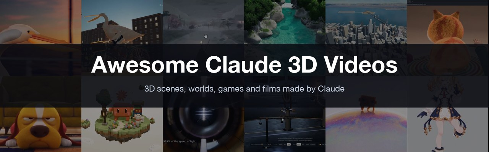

[English](README.md) · [中文](README.zh.md)

Claude 做的 3D 场景、世界、游戏和短片——用代码写出来（Three.js、WebGL、着色器、Blender Python）再渲成视频。 **476 条作品**，每条都链到作者的原帖； **80 条附作者公开的提示词**。

新的 Claude 模型一发布，第一批 3D 作品会在一天内收进来。

**用你自己的产品、照片或素材做一条 → [ultramotion.ai](https://ultramotion.ai/?utm_source=github&utm_medium=readme&utm_campaign=awesome-claude-3d-videos)**

## 目录
- [新模型首发](#新模型首发)
- [精选](#精选)
- [最受欢迎](#最受欢迎)
- [Games & interactive worlds](#games--interactive-worlds) (172)
- [Scenes & worlds](#scenes--worlds) (81)
- [Art & generative](#art--generative) (17)
- [Products & launches](#products--launches) (48)
- [Science & explainers](#science--explainers) (28)
- [History & culture](#history--culture) (11)
- [Short stories](#short-stories) (27)
- [Music videos](#music-videos) (10)
- [Humor](#humor) (4)
- [Data](#data) (7)
- [AI about itself](#ai-about-itself) (69)
- [Other](#other) (2)
- [收录标准](#收录标准)
- [署名](#署名)

标签是作者自己说用了什么： `Blender` `Three.js` `Shader` （WebGL/GLSL） `Unreal` `Tripo` `Bevy` `Godot` `Playable` （能在浏览器里玩）。没标签表示作者没说。

## 新模型首发

据报道 Claude Fable 5.5 和下一代 Opus 都快了，泄露的演示是 Three.js 和 Blender。发布当天的第一批 3D 作品放这里。

## 精选

按画面挑的最精美、最完整的作品，不看点赞。

<table>
<tr><td valign="top" width="33%"> <a href="https://x.com/AxtonLiu/status/2103119648271290566">Pelican riding a bicycle along pier</a> @AxtonLiu · ♥ 31</td><td valign="top" width="33%"><a href="https://x.com/addyosmani/status/2102436416437580159">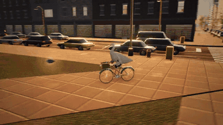</a> <a href="https://x.com/addyosmani/status/2102436416437580159">Pelican in a Three.js city (launch demo)</a> @addyosmani · ♥ 1,988</td><td valign="top" width="33%"><a href="https://x.com/MengTo/status/2102760783344189761">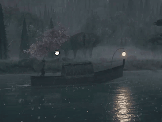</a> <a href="https://x.com/MengTo/status/2102760783344189761">Interactive Three.js Japanese boat scene</a> @MengTo · ♥ 5,817</td></tr>
<tr><td valign="top" width="33%"> <a href="https://x.com/hayashimon1/status/2102576886182453454">Three.js 3D river stream simulation</a> @hayashimon1 · ♥ 1,918</td><td valign="top" width="33%"><a href="https://x.com/MatthewBerman/status/2102483668468195539">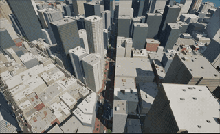</a> <a href="https://x.com/MatthewBerman/status/2102483668468195539">San Francisco in Unreal Engine with NPCs</a> @MatthewBerman · ♥ 2,224</td><td valign="top" width="33%"><a href="https://x.com/scottstts/status/2102498299190079933">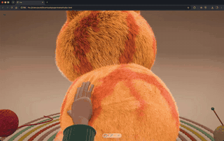</a> <a href="https://x.com/scottstts/status/2102498299190079933">Cat with GPU-rendered fur</a> @scottstts · ♥ 143</td></tr>
<tr><td valign="top" width="33%"> <a href="https://x.com/somasoma_blue/status/2103039084944138621">Slapstick cat and dog animation</a> @somasoma_blue · ♥ 12</td><td valign="top" width="33%"><a href="https://x.com/blueemi99/status/2102511304456212763">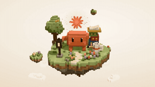</a> <a href="https://x.com/blueemi99/status/2102511304456212763">Self-portrait in voxel blocks</a> @blueemi99 · ♥ 573</td><td valign="top" width="33%"><a href="https://x.com/superalesha/status/2102779758408774104">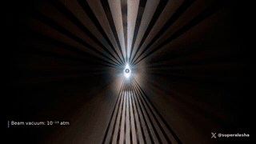</a> <a href="https://x.com/superalesha/status/2102779758408774104">LHC proton collision simulation</a> @superalesha · ♥ 537</td></tr>
<tr><td valign="top" width="33%"><a href="https://x.com/Voxyz_ai/status/2103117246860345550">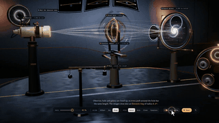</a> <a href="https://x.com/Voxyz_ai/status/2103117246860345550">Interactive black hole gravitational lensing lab</a> @Voxyz_ai · ♥ 15</td><td valign="top" width="33%"> <a href="https://x.com/Tariq_at/status/2102561072624410878">Claude Opus conceptual promo</a> @Tariq_at · ♥ 4</td><td valign="top" width="33%"><a href="https://x.com/manaimovie/status/2103138089790996843">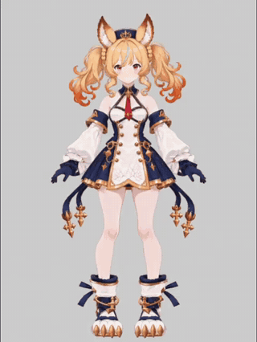</a> <a href="https://x.com/manaimovie/status/2103138089790996843">3D anime character animation demo</a> @manaimovie · ♥ 132</td></tr>
<tr><td valign="top" width="33%"> <a href="https://x.com/JustinPerea/status/2102893186330841502">Procedural demoscene generated by Opus</a> @JustinPerea · ♥ 981</td><td valign="top" width="33%"><a href="https://x.com/Stefan_3D_AI/status/2102471841046786153">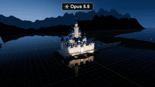</a> <a href="https://x.com/Stefan_3D_AI/status/2102471841046786153">Opus 5.5 vs GPT-6 3D test</a> @Stefan_3D_AI · ♥ 1,828</td><td valign="top" width="33%"> <a href="https://x.com/MengTo/status/2103122947133309311">3D dragon ship coded with Opus</a> @MengTo · ♥ 480</td></tr>
</table>

## 最受欢迎

<table>
<tr><td valign="top" width="33%"><a href="https://x.com/RyanSael/status/2102591147927654847">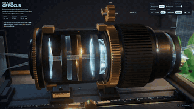</a> <a href="https://x.com/RyanSael/status/2102591147927654847">Interactive camera lens focus simulator</a> @RyanSael · ♥ 9,300</td><td valign="top" width="33%"> <a href="https://x.com/MengTo/status/2102760783344189761">Interactive Three.js Japanese boat scene</a> @MengTo · ♥ 5,817</td><td valign="top" width="33%"><a href="https://x.com/JaydenDavisNC/status/2103357848961036304">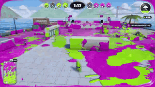</a> <a href="https://x.com/JaydenDavisNC/status/2103357848961036304">Splatoon game clone made by Opus</a> @JaydenDavisNC · ♥ 4,992</td></tr>
<tr><td valign="top" width="33%"><a href="https://x.com/higgsfield_ai/status/2102533401110802552">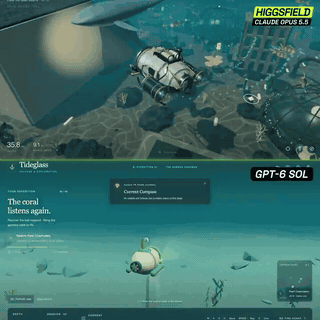</a> <a href="https://x.com/higgsfield_ai/status/2102533401110802552">AI 3D game dev comparison</a> @higgsfield_ai · ♥ 3,484</td><td valign="top" width="33%"><a href="https://x.com/alexalbert__/status/2102458348511879448">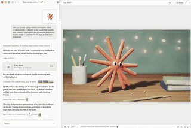</a> <a href="https://x.com/alexalbert__/status/2102458348511879448">Blender claymation from a one-shot prompt</a> @alexalbert__ · ♥ 2,640</td><td valign="top" width="33%"><a href="https://x.com/Aurelien_Gz/status/2102786378282987591">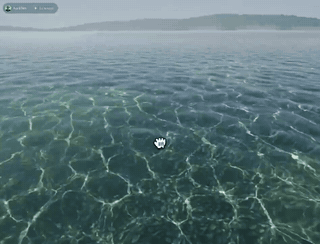</a> <a href="https://x.com/Aurelien_Gz/status/2102786378282987591">Interactive 3D water shader demo</a> @Aurelien_Gz · ♥ 2,591</td></tr>
<tr><td valign="top" width="33%"> <a href="https://x.com/MatthewBerman/status/2102483668468195539">San Francisco in Unreal Engine with NPCs</a> @MatthewBerman · ♥ 2,224</td><td valign="top" width="33%"><a href="https://x.com/techartist_/status/2102503719762018434">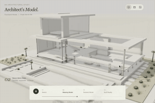</a> <a href="https://x.com/techartist_/status/2102503719762018434">Building growth sequence in 3D</a> @techartist_ · ♥ 1,993</td><td valign="top" width="33%"> <a href="https://x.com/addyosmani/status/2102436416437580159">Pelican in a Three.js city (launch demo)</a> @addyosmani · ♥ 1,988</td></tr>
<tr><td valign="top" width="33%"><a href="https://x.com/higgsfield_ai/status/2102507018372436264">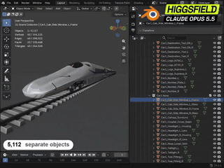</a> <a href="https://x.com/higgsfield_ai/status/2102507018372436264">Shinkansen with 5,112 parts and 430 seats</a> @higgsfield_ai · ♥ 1,918</td><td valign="top" width="33%"> <a href="https://x.com/hayashimon1/status/2102576886182453454">Three.js 3D river stream simulation</a> @hayashimon1 · ♥ 1,918</td><td valign="top" width="33%"><a href="https://x.com/aj_dev_smith/status/2102803889183736141">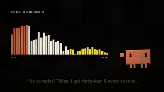</a> <a href="https://x.com/aj_dev_smith/status/2102803889183736141">Claude Opus rap music video</a> @aj_dev_smith · ♥ 1,842</td></tr>
<tr><td valign="top" width="33%"> <a href="https://x.com/Stefan_3D_AI/status/2102471841046786153">Opus 5.5 vs GPT-6 3D test</a> @Stefan_3D_AI · ♥ 1,828</td><td valign="top" width="33%"> <a href="https://x.com/alexalbert__/status/2102466523164274839">San Francisco street before the 1906 earthquake</a> @alexalbert__ · ♥ 1,163</td><td valign="top" width="33%"><a href="https://x.com/claudeai/status/2102471870692180179">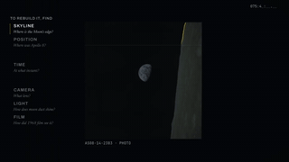</a> <a href="https://x.com/claudeai/status/2102471870692180179">Earthrise moment reconstructed in 3D</a> @claudeai · ♥ 1,088</td></tr>
<tr><td valign="top" width="33%"> <a href="https://x.com/JustinPerea/status/2102893186330841502">Procedural demoscene generated by Opus</a> @JustinPerea · ♥ 981</td><td valign="top" width="33%"><a href="https://x.com/LCSlates/status/2102503027340988559">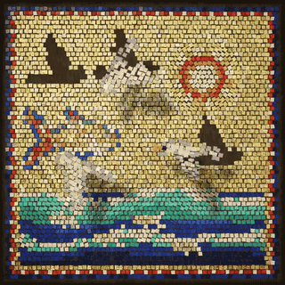</a> <a href="https://x.com/LCSlates/status/2102503027340988559">Animated mosaic tile art</a> @LCSlates · ♥ 970</td><td valign="top" width="33%"><a href="https://x.com/Hesamation/status/2103457566978162901">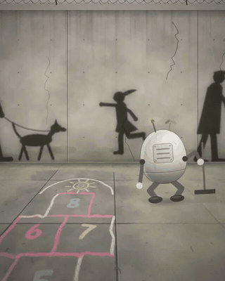</a> <a href="https://x.com/Hesamation/status/2103457566978162901">Lonely robot in a post-human world</a> @Hesamation · ♥ 833</td></tr>
<tr><td valign="top" width="33%"><a href="https://x.com/gandamu_ml/status/2102919394775220530">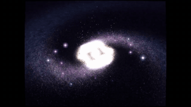</a> <a href="https://x.com/gandamu_ml/status/2102919394775220530">90s style demoscene demo</a> @gandamu_ml · ♥ 625</td><td valign="top" width="33%"> <a href="https://x.com/blueemi99/status/2102511304456212763">Self-portrait in voxel blocks</a> @blueemi99 · ♥ 573</td><td valign="top" width="33%"><a href="https://x.com/scheemunai/status/2102515382556954935">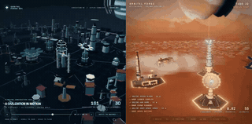</a> <a href="https://x.com/scheemunai/status/2102515382556954935">Orbital Forge planet base</a> @scheemunai · ♥ 559</td></tr>
<tr><td valign="top" width="33%"><a href="https://x.com/Stefan_3D_AI/status/2102641562824135022">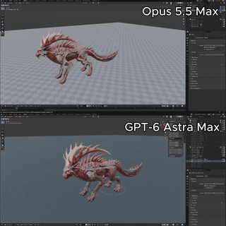</a> <a href="https://x.com/Stefan_3D_AI/status/2102641562824135022">Rigged 3D monster with animations in Blender</a> @Stefan_3D_AI · ♥ 553</td><td valign="top" width="33%"> <a href="https://x.com/superalesha/status/2102779758408774104">LHC proton collision simulation</a> @superalesha · ♥ 537</td><td valign="top" width="33%"><a href="https://x.com/RyanSael/status/2102740041621762166">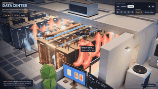</a> <a href="https://x.com/RyanSael/status/2102740041621762166">Interactive 3D AI data center simulation</a> @RyanSael · ♥ 483</td></tr>
</table>

- [Minecraft-style world with realistic lighting](https://x.com/ChrisGPT/status/2102644063950475477) — [@ChrisGPT](https://x.com/ChrisGPT) · ♥ 2,347
- [3D dragon ship coded with Opus](https://x.com/MengTo/status/2103122947133309311) — [@MengTo](https://x.com/MengTo) · ♥ 480
- [Hand-drawn catapult physics simulation](https://x.com/claudeai/status/2102471877184627062) — [@claudeai](https://x.com/claudeai) · ♥ 451
- [3D IKEA assembly guide](https://x.com/deedydas/status/2103174501345493197) — [@deedydas](https://x.com/deedydas) · ♥ 446
- [Testing Opus 5.5 controlling After Effects](https://x.com/aicreataro/status/2102656273112326609) — [@aicreataro](https://x.com/aicreataro) · ♥ 442
- [Walkable 3D house from a photo and floor plan](https://x.com/higgsfield_ai/status/2102499166635352354) — [@higgsfield_ai](https://x.com/higgsfield_ai) `Blender` · ♥ 410

## Games & interactive worlds

<table>
<tr><td valign="top" width="25%"><a href="https://x.com/MengTo/status/2102760783344189761">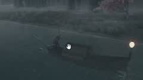</a> <a href="https://x.com/MengTo/status/2102760783344189761">Interactive Three.js Japanese boat scene</a> @MengTo · ♥ 5,817 <code>Three.js</code></td><td valign="top" width="25%"><a href="https://x.com/JaydenDavisNC/status/2103357848961036304">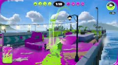</a> <a href="https://x.com/JaydenDavisNC/status/2103357848961036304">Splatoon game clone made by Opus</a> @JaydenDavisNC · ♥ 4,992 </td><td valign="top" width="25%"> <a href="https://x.com/Aurelien_Gz/status/2102786378282987591">Interactive 3D water shader demo</a> @Aurelien_Gz · ♥ 2,591 <code>Shader</code></td><td valign="top" width="25%"><a href="https://x.com/ChrisGPT/status/2102644063950475477">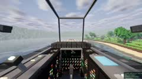</a> <a href="https://x.com/ChrisGPT/status/2102644063950475477">Minecraft-style world with realistic lighting</a> @ChrisGPT · ♥ 2,347 </td></tr>
<tr><td valign="top" width="25%"> <a href="https://x.com/MatthewBerman/status/2102483668468195539">San Francisco in Unreal Engine with NPCs</a> @MatthewBerman · ♥ 2,224 <code>Unreal</code></td><td valign="top" width="25%"> <a href="https://x.com/hayashimon1/status/2102576886182453454">Three.js 3D river stream simulation</a> @hayashimon1 · ♥ 1,918 <code>Three.js</code></td><td valign="top" width="25%"> <a href="https://x.com/scheemunai/status/2102515382556954935">Orbital Forge planet base</a> @scheemunai · ♥ 559 </td><td valign="top" width="25%"><a href="https://x.com/Stefan_3D_AI/status/2102641562824135022">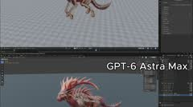</a> <a href="https://x.com/Stefan_3D_AI/status/2102641562824135022">Rigged 3D monster with animations in Blender</a> @Stefan_3D_AI · ♥ 553 <code>Blender</code></td></tr>
<tr><td valign="top" width="25%"><a href="https://x.com/RyanSael/status/2102740041621762166">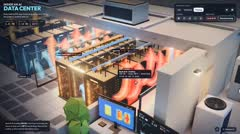</a> <a href="https://x.com/RyanSael/status/2102740041621762166">Interactive 3D AI data center simulation</a> @RyanSael · ♥ 483 </td><td valign="top" width="25%"> <a href="https://x.com/MengTo/status/2103122947133309311">3D dragon ship coded with Opus</a> @MengTo · ♥ 480 </td><td valign="top" width="25%"><a href="https://x.com/wizardbrainz/status/2102755328161116223">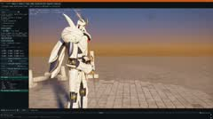</a> <a href="https://x.com/wizardbrainz/status/2102755328161116223">Realtime 3D mech test</a> @wizardbrainz · ♥ 24 </td><td valign="top" width="25%"> <a href="https://x.com/Maoku/status/2102539560702165495">Pachinko machine from an image</a> @Maoku · ♥ 15 </td></tr>
<tr><td valign="top" width="25%"> <a href="https://x.com/demgufever82151/status/2102444485020151835">3D virtual office Three.js walkthrough</a> @demgufever82151 <code>Three.js</code></td><td valign="top" width="25%"><a href="https://x.com/verdent_ai/status/2102445161834016836">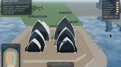</a> <a href="https://x.com/verdent_ai/status/2102445161834016836">3D Sydney Opera House interactive demo</a> @verdent_ai </td><td valign="top" width="25%"><a href="https://x.com/poolio/status/2102445641205248145">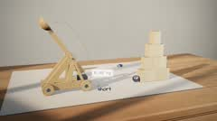</a> <a href="https://x.com/poolio/status/2102445641205248145">Sketch to 3D trebuchet physics simulation</a> @poolio </td><td valign="top" width="25%"><a href="https://x.com/cherry_mx_reds/status/2102449525944099320">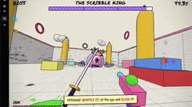</a> <a href="https://x.com/cherry_mx_reds/status/2102449525944099320">Doodle shooter game demo</a> @cherry_mx_reds </td></tr>
<tr><td valign="top" width="25%"><a href="https://x.com/higgsfield_ai/status/2102451096799330740">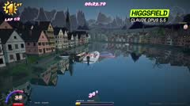</a> <a href="https://x.com/higgsfield_ai/status/2102451096799330740">Speedboat arcade racing game demo</a> @higgsfield_ai </td><td valign="top" width="25%"><a href="https://x.com/edwinarbus/status/2102463453176979794">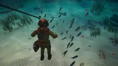</a> <a href="https://x.com/edwinarbus/status/2102463453176979794">Antikythera mechanism exploration game</a> @edwinarbus </td><td valign="top" width="25%"><a href="https://x.com/oguzthedev/status/2102476490344730950">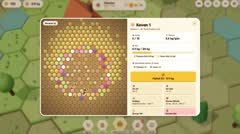</a> <a href="https://x.com/oguzthedev/status/2102476490344730950">AI-generated beekeeping game demo</a> @oguzthedev </td><td valign="top" width="25%"><a href="https://x.com/chaseleantj/status/2102480866404360215">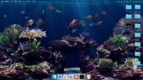</a> <a href="https://x.com/chaseleantj/status/2102480866404360215">Interactive coral reef desktop wallpaper</a> @chaseleantj </td></tr>
<tr><td valign="top" width="25%"> <a href="https://x.com/builderhelmai/status/2102483365261987938">Three.js kart racing game demo</a> @builderhelmai <code>Three.js</code></td><td valign="top" width="25%"><a href="https://x.com/anxuanng/status/2102492011710599526">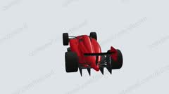</a> <a href="https://x.com/anxuanng/status/2102492011710599526">F1 car built in Three.js</a> @anxuanng <code>Three.js</code></td><td valign="top" width="25%"><a href="https://x.com/NicolaManzini/status/2102492538469044336">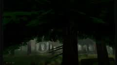</a> <a href="https://x.com/NicolaManzini/status/2102492538469044336">First-person forest walkthrough simulation</a> @NicolaManzini </td><td valign="top" width="25%"><a href="https://x.com/oboroge9/status/2102495834604523965">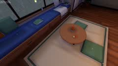</a> <a href="https://x.com/oboroge9/status/2102495834604523965">3D virtual room for AI character</a> @oboroge9 </td></tr>
<tr><td valign="top" width="25%"> <a href="https://x.com/Avenoxai/status/2102500841097756743">3D ocean water simulation demo</a> @Avenoxai </td><td valign="top" width="25%"><a href="https://x.com/_MaxBlade/status/2102513817855094922">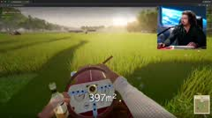</a> <a href="https://x.com/_MaxBlade/status/2102513817855094922">Multiplayer lawn mower simulator game demo</a> @_MaxBlade </td><td valign="top" width="25%"><a href="https://x.com/jpschroeder/status/2102517099323416630">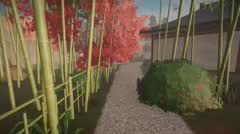</a> <a href="https://x.com/jpschroeder/status/2102517099323416630">Interactive 3D Japanese zen garden demo</a> @jpschroeder </td><td valign="top" width="25%"> <a href="https://x.com/DLKFZWilliam2/status/2102539136297230597">Interactive 3D retro study scene</a> @DLKFZWilliam2 </td></tr>
<tr><td valign="top" width="25%"> <a href="https://x.com/onofumi_AI/status/2102548517596381463">3D Osaka Castle in Three.js</a> @onofumi_AI <code>Three.js</code></td><td valign="top" width="25%"><a href="https://x.com/wawasensei/status/2102560721217393026">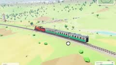</a> <a href="https://x.com/wawasensei/status/2102560721217393026">Interactive WebGPU train simulation demo</a> @wawasensei </td><td valign="top" width="25%"> <a href="https://x.com/dani_avila7/status/2102565161446064477">3D runner game optimization demo</a> @dani_avila7 </td><td valign="top" width="25%"> <a href="https://x.com/cryptomanavan/status/2102574467595567259">Interactive 3D waterfall simulation demo</a> @cryptomanavan </td></tr>
<tr><td valign="top" width="25%"> <a href="https://x.com/onofumi_AI/status/2102583417208717748">Smash Bros style fighting game demo</a> @onofumi_AI </td><td valign="top" width="25%"><a href="https://x.com/29meat_ai/status/2102586248829472940">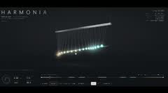</a> <a href="https://x.com/29meat_ai/status/2102586248829472940">Interactive pendulum wave visualizer</a> @29meat_ai </td><td valign="top" width="25%"> <a href="https://x.com/brucexu_eth/status/2102588236191396269">Pelican riding bicycle 3D game demo</a> @brucexu_eth </td><td valign="top" width="25%"><a href="https://x.com/alin_zone/status/2102608618751508947">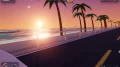</a> <a href="https://x.com/alin_zone/status/2102608618751508947">3D pelican riding bicycle demo</a> @alin_zone </td></tr>
<tr><td valign="top" width="25%"> <a href="https://x.com/Xudong07452910/status/2102627739874328679">Pelican riding bicycle 3D web game</a> @Xudong07452910 </td><td valign="top" width="25%"> <a href="https://x.com/alanchen/status/2102637689736667390">Pelican riding bicycle 3D game</a> @alanchen </td><td valign="top" width="25%"> <a href="https://x.com/Growmaxofficial/status/2102637754744230322">3D gym layout planner app</a> @Growmaxofficial </td><td valign="top" width="25%"> <a href="https://x.com/studio_veco/status/2102641653647581517">Three.js water simulation test</a> @studio_veco <code>Three.js</code></td></tr>
<tr><td valign="top" width="25%"><a href="https://x.com/linxiaobei888/status/2102644881307086894">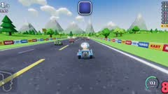</a> <a href="https://x.com/linxiaobei888/status/2102644881307086894">3D kart racing game demo</a> @linxiaobei888 </td><td valign="top" width="25%"><a href="https://x.com/NFT_Chen/status/2102672063668670725">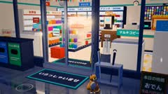</a> <a href="https://x.com/NFT_Chen/status/2102672063668670725">Rainy night 3D convenience store</a> @NFT_Chen </td><td valign="top" width="25%"> <a href="https://x.com/boltguo/status/2102672272888942901">Three.js Japanese cherry blossom valley</a> @boltguo <code>Three.js</code></td><td valign="top" width="25%"><a href="https://x.com/chongdashu/status/2102674509593796808">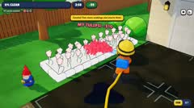</a> <a href="https://x.com/chongdashu/status/2102674509593796808">Pressure washing casual game demo</a> @chongdashu </td></tr>
<tr><td valign="top" width="25%"> <a href="https://x.com/wizardbrainz/status/2102680426573865160">Real-time 3D gothic hall walkthrough</a> @wizardbrainz </td><td valign="top" width="25%"> <a href="https://x.com/studio_veco/status/2102684366996738511">Interactive cute 3D village demo</a> @studio_veco </td><td valign="top" width="25%"><a href="https://x.com/huxlab/status/2102684995571859707">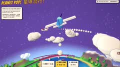</a> <a href="https://x.com/huxlab/status/2102684995571859707">Interactive 3D cartoon planet web game</a> @huxlab </td><td valign="top" width="25%"> <a href="https://x.com/KrishBakshi_/status/2102713213414711712">Testing Opus 5.5 on WorldBench</a> @KrishBakshi_ </td></tr>
<tr><td valign="top" width="25%"> <a href="https://x.com/alin_zone/status/2102713879986131252">CrossFire cargo ship FPS game recreation</a> @alin_zone </td><td valign="top" width="25%"> <a href="https://x.com/mfranz_on/status/2102718643050008753">3D web game demo made with Opus</a> @mfranz_on </td><td valign="top" width="25%"> <a href="https://x.com/fastLLM/status/2102729061864993064">Interactive 3D Bumblebee web demo</a> @fastLLM </td><td valign="top" width="25%"> <a href="https://x.com/srikanthvaluri/status/2102729319772790985">Procedural Three.js watercolor backyard garden</a> @srikanthvaluri <code>Three.js</code></td></tr>
<tr><td valign="top" width="25%"> <a href="https://x.com/ZhenZhu200/status/2102735011158044927">3D pelican bicycle web game demo</a> @ZhenZhu200 </td><td valign="top" width="25%"> <a href="https://x.com/hayashimon1/status/2102737051057832358">Three.js river fishing game demo</a> @hayashimon1 <code>Three.js</code></td><td valign="top" width="25%"> <a href="https://x.com/AGI_FromWalmart/status/2102739444256383089">Voxel soccer goal animation</a> @AGI_FromWalmart </td><td valign="top" width="25%"> <a href="https://x.com/zibxx/status/2102745966214312137">Transforming mech racing game showcase</a> @zibxx </td></tr>
<tr><td valign="top" width="25%"> <a href="https://x.com/AISuperDomain/status/2102755459232899446">3D house exploration from floorplan</a> @AISuperDomain </td><td valign="top" width="25%"> <a href="https://x.com/cherry_mx_reds/status/2102762471543144631">Opus 5.5 generated racing game</a> @cherry_mx_reds </td><td valign="top" width="25%"> <a href="https://x.com/xingbugengming/status/2102768464893181963">Three.js 3D basketball web game demo</a> @xingbugengming <code>Three.js</code></td><td valign="top" width="25%"> <a href="https://x.com/nachat_dayo/status/2102773498037023140">Spearfishing 3D game demo</a> @nachat_dayo </td></tr>
<tr><td valign="top" width="25%"> <a href="https://x.com/blitast_studio/status/2102775461701091531">Side-scrolling night street game demo</a> @blitast_studio </td><td valign="top" width="25%"> <a href="https://x.com/andrewkittridge/status/2102786499695517770">Interactive 3D cozy fall clearing</a> @andrewkittridge </td><td valign="top" width="25%"> <a href="https://x.com/sciencedegens/status/2102793141095121342">Pelican riding bicycle interactive 3D game</a> @sciencedegens </td><td valign="top" width="25%"> <a href="https://x.com/Yakinik/status/2102795352520949864">Game demo created by Opus 5.5</a> @Yakinik </td></tr>
<tr><td valign="top" width="25%"> <a href="https://x.com/NicksonTan/status/2102798578427265368">Interactive Three.js 3D river scene</a> @NicksonTan <code>Blender</code> <code>Three.js</code></td><td valign="top" width="25%"> <a href="https://x.com/brnczr/status/2102799187364466988">Three.js 3D music sampler demo</a> @brnczr <code>Three.js</code></td><td valign="top" width="25%"> <a href="https://x.com/KanaWorks_AI/status/2102801635638673762">2.5D pixel art rainy campfire game</a> @KanaWorks_AI </td><td valign="top" width="25%"> <a href="https://x.com/Tino_Xu_/status/2102805556645990854">Three.js river rafting game demo</a> @Tino_Xu_ <code>Three.js</code></td></tr>
<tr><td valign="top" width="25%"> <a href="https://x.com/amodexbt/status/2102806581565923344">Playable 3D world built with Opus</a> @amodexbt </td><td valign="top" width="25%"> <a href="https://x.com/techartist_/status/2102813614797472162">Interactive 3D adaptive micro apartment</a> @techartist_ </td><td valign="top" width="25%"> <a href="https://x.com/Skirook/status/2102814910396985394">Interactive 3D solar system demo</a> @Skirook </td><td valign="top" width="25%"> <a href="https://x.com/JaydenDavisNC/status/2102828630615421223">Splatoon style game generated by AI</a> @JaydenDavisNC </td></tr>
<tr><td valign="top" width="25%"> <a href="https://x.com/theo/status/2102877145399975952">AI-generated 3D underwater game gameplay</a> @theo </td><td valign="top" width="25%"> <a href="https://x.com/bijanbowen/status/2102886669162782727">Guitar store simulator game playtest</a> @bijanbowen </td><td valign="top" width="25%"> <a href="https://x.com/hayashimon1/status/2102896421418709488">Three.js river fishing game showcase</a> @hayashimon1 <code>Three.js</code></td><td valign="top" width="25%"> <a href="https://x.com/Yakinik/status/2102907094123037079">Automated Zundamon game commentary</a> @Yakinik </td></tr>
<tr><td valign="top" width="25%"> <a href="https://x.com/rehan_shei/status/2102924598472020219">AI boat game comparison</a> @rehan_shei </td><td valign="top" width="25%"> <a href="https://x.com/shingo2000/status/2102926109360951391">Three.js bird flight browser game demo</a> @shingo2000 <code>Three.js</code></td><td valign="top" width="25%"> <a href="https://x.com/xikhar/status/2102932763750084797">Three.js Spider-Man game demo</a> @xikhar <code>Three.js</code></td><td valign="top" width="25%"> <a href="https://x.com/Hamburgerai/status/2102954473400529326">Interactive 3D pelican cycling demo</a> @Hamburgerai </td></tr>
<tr><td valign="top" width="25%"> <a href="https://x.com/KanaWorks_AI/status/2102955708321062975">Godot 3D dice battler game demo</a> @KanaWorks_AI <code>Godot</code></td><td valign="top" width="25%"> <a href="https://x.com/sciencedegens/status/2102962126675640642">Spider-Man 3D web game demo</a> @sciencedegens </td><td valign="top" width="25%"> <a href="https://x.com/knikzstore/status/2102965695520911549">3D ink wash stickman battle demo</a> @knikzstore </td><td valign="top" width="25%"> <a href="https://x.com/BubuStd/status/2102991290568954264">Dynasty Warriors web game demo</a> @BubuStd </td></tr>
<tr><td valign="top" width="25%"> <a href="https://x.com/NSJunXiu/status/2103002113114767683">3D binder carousel UI demo</a> @NSJunXiu </td><td valign="top" width="25%"> <a href="https://x.com/MartinBe4781/status/2103002306572628280">Browser racing game update showcase</a> @MartinBe4781 </td><td valign="top" width="25%"> <a href="https://x.com/thebuggeddev/status/2103002563042042042">Fluffy Three.js social buttons demo</a> @thebuggeddev <code>Three.js</code></td><td valign="top" width="25%"> <a href="https://x.com/pparik__/status/2103002742172356768">Star Wars voxel flight game</a> @pparik__ </td></tr>
<tr><td valign="top" width="25%"> <a href="https://x.com/sciencedegens/status/2103007271248904326">3D Sakura Crossing walkthrough scene</a> @sciencedegens </td><td valign="top" width="25%"> <a href="https://x.com/chetanankola/status/2103008022369099992">Interactive Three.js driving game demo</a> @chetanankola <code>Three.js</code></td><td valign="top" width="25%"> <a href="https://x.com/FreiuDiziplin/status/2103008455837548704">AI built 3D snowboarding game demo</a> @FreiuDiziplin </td><td valign="top" width="25%"> <a href="https://x.com/AungKyawPaingx/status/2103009968731648447">Minecraft running in Blender addon</a> @AungKyawPaingx <code>Blender</code></td></tr>
<tr><td valign="top" width="25%"> <a href="https://x.com/suck_a_sage/status/2103010834658316782">Three.js 3D realistic aquarium simulation</a> @suck_a_sage <code>Three.js</code></td><td valign="top" width="25%"> <a href="https://x.com/sciencedegens/status/2103017742144336131">3D Dynasty Warriors browser game remake</a> @sciencedegens </td><td valign="top" width="25%"> <a href="https://x.com/Stravant/status/2103022003863355796">AI-generated Yu-Gi-Oh card game</a> @Stravant </td><td valign="top" width="25%"> <a href="https://x.com/chudry223/status/2103044654187081860">Interactive 3D camera lens lab</a> @chudry223 <code>Shader</code> <code>Three.js</code></td></tr>
<tr><td valign="top" width="25%"> <a href="https://x.com/happycapyai/status/2103057174855634965">Bomberman clone game demo</a> @happycapyai <code>Playable</code> <code>Three.js</code></td><td valign="top" width="25%"> <a href="https://x.com/hamster_wat/status/2103076399741559076">Three.js Japanese taxi 3D model</a> @hamster_wat <code>Three.js</code></td><td valign="top" width="25%"> <a href="https://x.com/literallydenis/status/2103088660887318850">Three.js retro first-person RPG game</a> @literallydenis <code>Three.js</code></td><td valign="top" width="25%"> <a href="https://x.com/e_page/status/2103091545696338311">3D game character showcase</a> @e_page </td></tr>
<tr><td valign="top" width="25%"> <a href="https://x.com/goan999999/status/2103098774738628780">Pelican bicycle racing game demo</a> @goan999999 </td><td valign="top" width="25%"> <a href="https://x.com/sahilvermaai/status/2103107976445808892">Interactive 3D wildlife photography portfolio</a> @sahilvermaai </td><td valign="top" width="25%"> <a href="https://x.com/oguzthedev/status/2103124031201542221">Showcase of AI generated casual games</a> @oguzthedev </td><td valign="top" width="25%"> <a href="https://x.com/anduraio/status/2103133601143665072">Three.js claymorphism racing game demo</a> @anduraio <code>Three.js</code></td></tr>
<tr><td valign="top" width="25%"> <a href="https://x.com/KanaWorks_AI/status/2103138051165933661">ARPG gameplay demo in Unreal Engine</a> @KanaWorks_AI <code>Unreal</code></td><td valign="top" width="25%"> <a href="https://x.com/cnyzgkc/status/2103140410453569565">Dynasty Warriors 3D web game demo</a> @cnyzgkc </td><td valign="top" width="25%"> <a href="https://x.com/preferedev/status/2103144241509900739">Roblox moon game created with Claude</a> @preferedev </td><td valign="top" width="25%"> <a href="https://x.com/gamechaiin/status/2103149723787907130">Game chest opening animations demo</a> @gamechaiin </td></tr>
<tr><td valign="top" width="25%"> <a href="https://x.com/_mackenziebowes/status/2103151027528843595">Procgen game tools built with Opus</a> @_mackenziebowes </td><td valign="top" width="25%"> <a href="https://x.com/yearemias/status/2103151040774435315">Salmon Survival game demo</a> @yearemias </td><td valign="top" width="25%"> <a href="https://x.com/BuildFastWithAI/status/2103152898708582551">Procedural Three.js Skyraider warbird demo</a> @BuildFastWithAI · <a href="prompts/buildfastwithai-582551.md">prompt</a> <code>Three.js</code></td><td valign="top" width="25%"> <a href="https://x.com/LexnLin/status/2103153535252582792">Museum of Wrong Physics demo</a> @LexnLin </td></tr>
<tr><td valign="top" width="25%"> <a href="https://x.com/21stRobotics/status/2103160531653976542">Opus 3D Spider-Man game demo</a> @21stRobotics </td><td valign="top" width="25%"> <a href="https://x.com/nkgoutham/status/2103165227722555623">3D Silk Board junction in browser</a> @nkgoutham </td><td valign="top" width="25%"> <a href="https://x.com/swapp19902/status/2103167327261089926">UE5 NPC interaction demo</a> @swapp19902 </td><td valign="top" width="25%"> <a href="https://x.com/SadraMajidi04/status/2103167580705898654">Interactive Japanese landscape boat demo</a> @SadraMajidi04 </td></tr>
<tr><td valign="top" width="25%"> <a href="https://x.com/DannyLimanseta/status/2103169095034400772">ThreeJS 3D Atlantis interactive tour</a> @DannyLimanseta <code>Three.js</code></td><td valign="top" width="25%"> <a href="https://x.com/ToolBraidComp/status/2103171359056752729">Indie game LUMENFALL gameplay preview</a> @ToolBraidComp </td><td valign="top" width="25%"> <a href="https://x.com/superalesha/status/2103184664597029221">FPS bodycam game teaser</a> @superalesha </td><td valign="top" width="25%"> <a href="https://x.com/mrblock/status/2103202300038889776">Three.js Atlantis 3D world demo</a> @mrblock <code>Three.js</code></td></tr>
<tr><td valign="top" width="25%"> <a href="https://x.com/BhavikY663/status/2103203537669030195">3D archery game built with Opus</a> @BhavikY663 </td><td valign="top" width="25%"> <a href="https://x.com/niklaslenz_ai/status/2103216596537819204">Living voxel diorama generated by code</a> @niklaslenz_ai </td><td valign="top" width="25%"> <a href="https://x.com/oboroge9/status/2103228962315137315">AI-generated 3D room showcase</a> @oboroge9 </td><td valign="top" width="25%"> <a href="https://x.com/0x0SojalSec/status/2103231007025668364">Browser-based Sekiro boss fight</a> @0x0SojalSec </td></tr>
<tr><td valign="top" width="25%"> <a href="https://x.com/learn2vibecode/status/2103232512856359406">Temple Run clone made with Opus</a> @learn2vibecode </td><td valign="top" width="25%"> <a href="https://x.com/0x0SojalSec/status/2103232621669220827">Procedural 3D browser bike ride</a> @0x0SojalSec </td><td valign="top" width="25%"> <a href="https://x.com/M4nuraj11/status/2103233893512122551">Root Rite horror game demo</a> @M4nuraj11 </td><td valign="top" width="25%"> <a href="https://x.com/0xProbabillity/status/2103234092091248768">Multiplayer voxel game built with Claude</a> @0xProbabillity </td></tr>
<tr><td valign="top" width="25%"> <a href="https://x.com/chetanankola/status/2103242557069431197">Stylized interactive racing game demo</a> @chetanankola </td><td valign="top" width="25%"> <a href="https://x.com/scarycatbite47/status/2103243022515507346">Roblox game development gameplay demo</a> @scarycatbite47 </td><td valign="top" width="25%"> <a href="https://x.com/mezdez/status/2103246021463802290">AI agent 3D house modeling in Rhino</a> @mezdez </td><td valign="top" width="25%"> <a href="https://x.com/Delroy715/status/2103305564973658114">Realistic 3D water simulation demo</a> @Delroy715 </td></tr>
<tr><td valign="top" width="25%"> <a href="https://x.com/coder_left/status/2103402593959420170">AI-generated web FPS multiplayer game</a> @coder_left </td><td valign="top" width="25%"> <a href="https://x.com/nixonyh06/status/2103441622566625769">Radiance cascades global illumination demo</a> @nixonyh06 </td><td valign="top" width="25%"> <a href="https://x.com/mdaman010/status/2103444104604741861">Japanese style 3D boating browser game</a> @mdaman010 </td><td valign="top" width="25%"> <a href="https://x.com/AdarshSubham1/status/2103453265568690288">Defense drone concept website showcase</a> @AdarshSubham1 </td></tr>
<tr><td valign="top" width="25%"> <a href="https://x.com/karankendre/status/2103456630679773669">Claude-built 3D sniper game demo</a> @karankendre </td><td valign="top" width="25%"> <a href="https://x.com/MartinBe4781/status/2103492369077449019">Mushroom Rally gameplay update preview</a> @MartinBe4781 </td><td valign="top" width="25%"> <a href="https://x.com/anduraio/status/2103492560417431929">Claymation platformer game showcase</a> @anduraio </td><td valign="top" width="25%"> <a href="https://x.com/nicoichi_k/status/2103492763358786022">3D character motion generation demo</a> @nicoichi_k </td></tr>
<tr><td valign="top" width="25%"> <a href="https://x.com/mrblock/status/2103492984474096062">3D arcade racing game demo</a> @mrblock <code>Shader</code> <code>Three.js</code></td><td valign="top" width="25%"> <a href="https://x.com/DannyLimanseta/status/2103493389778125083">3D interactive habitat garden simulator demo</a> @DannyLimanseta </td><td valign="top" width="25%"> <a href="https://x.com/onlyfryouu13/status/2103494250218553481">AI-generated Metin2 style 3D game</a> @onlyfryouu13 </td><td valign="top" width="25%"> <a href="https://x.com/_IamAlam/status/2103494804252557653">Japanese river boat browser game</a> @_IamAlam </td></tr>
<tr><td valign="top" width="25%"> <a href="https://x.com/_IamAlam/status/2103494839736426775">Trolley problem 3D mini game</a> @_IamAlam </td><td valign="top" width="25%"> <a href="https://x.com/frangss_/status/2103494969075933450">Recreating Cube Wars game</a> @frangss_ </td><td valign="top" width="25%"> <a href="https://x.com/akinkeskinbas/status/2103495834872742071">Roblox dress maker game showcase</a> @akinkeskinbas </td><td valign="top" width="25%"> <a href="https://x.com/devJunaid1/status/2103537184011845735">Winner badge animation demo</a> @devJunaid1 </td></tr>
<tr><td valign="top" width="25%"> <a href="https://x.com/jarvis11x/status/2103816821782544635">Third-person stroll through nighttime town</a> @jarvis11x <code>Shader</code> <code>Three.js</code></td><td valign="top" width="25%"> <a href="https://x.com/Sceat_/status/2103825721307349480">Moonwalking goblins in Three.js game</a> @Sceat_ <code>Three.js</code></td><td valign="top" width="25%"> <a href="https://x.com/miguelh1dalgo/status/2103826046890188899">Attack on Titan 3D game demo</a> @miguelh1dalgo </td><td valign="top" width="25%"> <a href="https://x.com/poojabnf/status/2103827662691344730">Procedural mountain flight simulator demo</a> @poojabnf </td></tr>
<tr><td valign="top" width="25%"> <a href="https://x.com/anbu369/status/2103830442184978770">F1 live 3D race telemetry dashboard</a> @anbu369 </td><td valign="top" width="25%"> <a href="https://x.com/_rjach/status/2103830991441973447">AI generated Subway Surfers game clone</a> @_rjach </td><td valign="top" width="25%"> <a href="https://x.com/LaN_Thoughts/status/2103831516161966087">Interactive 3D house design tool demo</a> @LaN_Thoughts </td></tr>
</table>

- [Dark Souls style 3D game demo](https://x.com/gamechaiin/status/2102450364398047409) — [@gamechaiin](https://x.com/gamechaiin)
- [3D guitar store simulation game](https://x.com/bijanbowen/status/2102532400353829356) — [@bijanbowen](https://x.com/bijanbowen)
- [Polar bear aquarium 3D interactive scene](https://x.com/KanaWorks_AI/status/2102779235349967310) — [@KanaWorks_AI](https://x.com/KanaWorks_AI)
- [Browser Three.js Rocket League clone](https://x.com/robko_rl/status/2102879831834952007) — [@robko_rl](https://x.com/robko_rl) `Three.js`
- [Interactive Peach Blossom Spring 3D demo](https://x.com/dotey/status/2102940980379017293) — [@dotey](https://x.com/dotey)
- [Three.js desert oasis 3D exploration](https://x.com/cryptomanavan/status/2102957938272763939) — [@cryptomanavan](https://x.com/cryptomanavan) `Three.js`
- [3D gacha pull simulation](https://x.com/0xMarioWu/status/2102984028488130954) — [@0xMarioWu](https://x.com/0xMarioWu)
- [WebGPU cozy fishing game demo](https://x.com/dangreenheck/status/2103004432786993341) — [@dangreenheck](https://x.com/dangreenheck)
- [Three.js interactive river boat scene](https://x.com/aokocax/status/2103011071820996673) — [@aokocax](https://x.com/aokocax) `Three.js`
- [Cyberpunk pixel art city demo](https://x.com/Gorden_Sun/status/2103079013615034692) — [@Gorden_Sun](https://x.com/Gorden_Sun)
- [Pokemon 3D battle animation demo](https://x.com/Ror_Fly/status/2103150045012930941) — [@Ror_Fly](https://x.com/Ror_Fly)
- [Interactive 3D island environment demo](https://x.com/Acemation_/status/2103150350211354966) — [@Acemation_](https://x.com/Acemation_)
- [Claude Opus 5.5 Katamari-style game demo](https://x.com/Nickxyzn/status/2103152868937150814) — [@Nickxyzn](https://x.com/Nickxyzn)
- [Anime 3D soccer game made with Opus](https://x.com/FabioAngela79/status/2103236554911252926) — [@FabioAngela79](https://x.com/FabioAngela79)
- [Getting Over It remake demo](https://x.com/MinimunchYT/status/2103245138604839403) — [@MinimunchYT](https://x.com/MinimunchYT)
- [Interactive crowd avoidance meme demo](https://x.com/_pigeon______/status/2103429586285437131) — [@_pigeon______](https://x.com/_pigeon______)
- [3D paragliding flight game demo](https://x.com/ManasJoshi76254/status/2103480600112103725) — [@ManasJoshi76254](https://x.com/ManasJoshi76254)

## Scenes & worlds

<table>
<tr><td valign="top" width="25%"> <a href="https://x.com/techartist_/status/2102503719762018434">Building growth sequence in 3D</a> @techartist_ · ♥ 1,993 <code>Three.js</code></td><td valign="top" width="25%"> <a href="https://x.com/addyosmani/status/2102436416437580159">Pelican in a Three.js city (launch demo)</a> @addyosmani · ♥ 1,988 <code>Three.js</code></td><td valign="top" width="25%"> <a href="https://x.com/higgsfield_ai/status/2102507018372436264">Shinkansen with 5,112 parts and 430 seats</a> @higgsfield_ai · ♥ 1,918 <code>Blender</code></td><td valign="top" width="25%"> <a href="https://x.com/higgsfield_ai/status/2102499166635352354">Walkable 3D house from a photo and floor plan</a> @higgsfield_ai · ♥ 410 <code>Blender</code></td></tr>
<tr><td valign="top" width="25%"> <a href="https://x.com/Michaelzsguo/status/2102592355165782312">Sand animation of American history</a> @Michaelzsguo · ♥ 309 · <a href="prompts/michaelzsguo-782312.md">prompt</a> <code>Blender</code> <code>Shader</code> <code>Three.js</code></td><td valign="top" width="25%"> <a href="https://x.com/vib3coded/status/2102450239923720440">Volcanic island with sea life and aurora</a> @vib3coded · ♥ 208 </td><td valign="top" width="25%"> <a href="https://x.com/__morse/status/2103485566570369333">UI shape morphing animation sequence</a> @__morse · <a href="prompts/morse-369333.md">prompt</a> </td><td valign="top" width="25%"> <a href="https://x.com/lukasersil/status/2103742861971726495">Advanced motion graphics designer showreel</a> @lukasersil · <a href="prompts/lukasersil-726495.md">prompt</a> <code>Shader</code> <code>Three.js</code></td></tr>
<tr><td valign="top" width="25%"> <a href="https://x.com/BThreeAgency/status/2103739079745827092">Premium badge unlock celebration scene</a> @BThreeAgency · <a href="prompts/bthreeagency-827092.md">prompt</a> </td><td valign="top" width="25%"> <a href="https://x.com/twoclipping/status/2103835273813496100">Brand launch film continuous take</a> @twoclipping · <a href="prompts/twoclipping-496100.md">prompt</a> </td><td valign="top" width="25%"> <a href="https://x.com/mdaman010/status/2103845689713111079">AI data center interior visualization</a> @mdaman010 · <a href="prompts/mdaman010-111079.md">prompt</a> <code>Shader</code> <code>Three.js</code></td><td valign="top" width="25%"> <a href="https://x.com/Sayan_shanky/status/2103736579449868515">AI data center visualization</a> @Sayan_shanky · <a href="prompts/sayan-shanky-868515.md">prompt</a> <code>Shader</code> <code>Three.js</code></td></tr>
<tr><td valign="top" width="25%"> <a href="https://x.com/BuildFastWithAI/status/2103483174957597035">Three dimensional pagoda exploration</a> @BuildFastWithAI · <a href="prompts/buildfastwithai-597035.md">prompt</a> <code>Three.js</code></td><td valign="top" width="25%"> <a href="https://x.com/RaphaelAubryy/status/2103413596822687877">Minimal product showcase motion video</a> @RaphaelAubryy · <a href="prompts/raphaelaubryy-687877.md">prompt</a> </td><td valign="top" width="25%"> <a href="https://x.com/anirockshady/status/2103195903012032809">Gradient descent ball movement animation</a> @anirockshady · <a href="prompts/anirockshady-032809.md">prompt</a> <code>Shader</code> <code>Three.js</code></td><td valign="top" width="25%"> <a href="https://x.com/ishuagra02/status/2102920408743678129">Particle illustration beach environment</a> @ishuagra02 · <a href="prompts/ishuagra02-678129.md">prompt</a> <code>Shader</code> <code>Three.js</code></td></tr>
<tr><td valign="top" width="25%"> <a href="https://x.com/MondemSuraj/status/2108716642540691517">Golden Gate Bridge with effects</a> @MondemSuraj · <a href="prompts/mondemsuraj-691517.md">prompt</a> <code>Shader</code> <code>Three.js</code></td><td valign="top" width="25%"> <a href="https://x.com/aichrislee/status/2107622585307476025">Interactive mechanical watch mechanism</a> @aichrislee · <a href="prompts/aichrislee-476025.md">prompt</a> <code>Three.js</code></td><td valign="top" width="25%"> <a href="https://x.com/thebuggeddev/status/2107449104926482912">Procedural Napoleon field cannon</a> @thebuggeddev · <a href="prompts/thebuggeddev-482912.md">prompt</a> <code>Blender</code> <code>Shader</code> <code>Three.js</code></td><td valign="top" width="25%"> <a href="https://x.com/Thusatharan/status/2108544807333433543">Procedural golden hour manor</a> @Thusatharan · <a href="prompts/thusatharan-433543.md">prompt</a> </td></tr>
<tr><td valign="top" width="25%"> <a href="https://x.com/rubenssoto_ai/status/2108512810774802657">Formula One pit stop scene</a> @rubenssoto_ai · <a href="prompts/rubenssoto-ai-802657.md">prompt</a> <code>Three.js</code></td><td valign="top" width="25%"> <a href="https://x.com/Thusatharan/status/2108511286795640926">Procedural three dimensional elephant</a> @Thusatharan · <a href="prompts/thusatharan-640926.md">prompt</a> <code>Three.js</code></td><td valign="top" width="25%"> <a href="https://x.com/shunshu32385143/status/2108480534254944719">Temple of Heaven architectural rendering</a> @shunshu32385143 · <a href="prompts/shunshu32385143-944719.md">prompt</a> <code>Three.js</code></td><td valign="top" width="25%"> <a href="https://x.com/BuildFastWithAI/status/2108403445304844291">Audio reactive particle animation</a> @BuildFastWithAI · <a href="prompts/buildfastwithai-844291.md">prompt</a> <code>Shader</code></td></tr>
<tr><td valign="top" width="25%"> <a href="https://x.com/cryptowluha/status/2108253385829060792">House sketch to finished drawing</a> @cryptowluha · <a href="prompts/cryptowluha-060792.md">prompt</a> <code>Three.js</code></td><td valign="top" width="25%"> <a href="https://x.com/tonysurix/status/2108230699224596746">Mountain car chase sequence</a> @tonysurix · <a href="prompts/tonysurix-596746.md">prompt</a> <code>Blender</code></td><td valign="top" width="25%"> <a href="https://x.com/SimonasLTU1/status/2108175272964981181">Dreams made real visual experience</a> @SimonasLTU1 · <a href="prompts/simonasltu1-981181.md">prompt</a> <code>Three.js</code></td><td valign="top" width="25%"> <a href="https://x.com/btcup99/status/2108152460523311469">Artificial intelligence development history</a> @btcup99 · <a href="prompts/btcup99-311469.md">prompt</a> <code>Three.js</code></td></tr>
<tr><td valign="top" width="25%"> <a href="https://x.com/mdaman010/status/2108108452774207866">Middle earth miniature world journey</a> @mdaman010 · <a href="prompts/mdaman010-207866.md">prompt</a> <code>Three.js</code></td><td valign="top" width="25%"> <a href="https://x.com/wikiwayne/status/2108025937212080350">Stop motion claymation desk scene</a> @wikiwayne · <a href="prompts/wikiwayne-080350.md">prompt</a> <code>Blender</code> <code>Three.js</code></td><td valign="top" width="25%"> <a href="https://x.com/wikiwayne/status/2107951058584486055">Procedural claymation desk animation</a> @wikiwayne · <a href="prompts/wikiwayne-486055.md">prompt</a> <code>Blender</code></td><td valign="top" width="25%"> <a href="https://x.com/mdaman010/status/2107888264904610173">Middle earth epic cinematic journey</a> @mdaman010 · <a href="prompts/mdaman010-610173.md">prompt</a> <code>Three.js</code></td></tr>
<tr><td valign="top" width="25%"> <a href="https://x.com/okazaky/status/2107826563786084783">Programmatic vertical music video</a> @okazaky · <a href="prompts/okazaky-084783.md">prompt</a> <code>Three.js</code></td><td valign="top" width="25%"> <a href="https://x.com/aicreataro/status/2107794785188864070">Story motion animation video</a> @aicreataro · <a href="prompts/aicreataro-864070.md">prompt</a> <code>Three.js</code></td><td valign="top" width="25%"> <a href="https://x.com/NFT_Chen/status/2107653056771068069">Traditional animation techniques showcase</a> @NFT_Chen · <a href="prompts/nft-chen-068069.md">prompt</a> <code>Shader</code> <code>Three.js</code></td><td valign="top" width="25%"> <a href="https://x.com/tanabe_fragm/status/2107644501372322001">Tile mosaic advertisement reveal</a> @tanabe_fragm · <a href="prompts/tanabe-fragm-322001.md">prompt</a> <code>Three.js</code></td></tr>
<tr><td valign="top" width="25%"> <a href="https://x.com/llama3dstudio/status/2107504609207918962">Fried chicken preparation animation</a> @llama3dstudio · <a href="prompts/llama3dstudio-918962.md">prompt</a> <code>Three.js</code></td><td valign="top" width="25%"> <a href="https://x.com/rafiroutes/status/2107465888622596199">Anime opening teaser animation</a> @rafiroutes · <a href="prompts/rafiroutes-596199.md">prompt</a> <code>Blender</code> <code>Shader</code> <code>Three.js</code></td><td valign="top" width="25%"> <a href="https://x.com/kisaka_ki/status/2107054815255859326">Debris flow sediment visualization</a> @kisaka_ki · <a href="prompts/kisaka-ki-859326.md">prompt</a> </td><td valign="top" width="25%"> <a href="https://x.com/SadAlbert10/status/2106789700807856416">Voxel art pelican bicycle ride</a> @SadAlbert10 · <a href="prompts/sadalbert10-856416.md">prompt</a> </td></tr>
<tr><td valign="top" width="25%"> <a href="https://x.com/dan__proggg/status/2106477834873274533">Ancient pagoda architectural construction</a> @dan__proggg · <a href="prompts/dan-proggg-274533.md">prompt</a> <code>Blender</code> <code>Three.js</code></td><td valign="top" width="25%"> <a href="https://x.com/riyadbkhsh/status/2106467130963300736">Times Square billboard launch video</a> @riyadbkhsh · <a href="prompts/riyadbkhsh-300736.md">prompt</a> </td><td valign="top" width="25%"> <a href="https://x.com/generussai/status/2105921281673904308">Sacred geometry visual animation</a> @generussai · <a href="prompts/generussai-904308.md">prompt</a> </td><td valign="top" width="25%"> <a href="https://x.com/oab10don/status/2105879685322457273">Automated dance performance rendering</a> @oab10don · <a href="prompts/oab10don-457273.md">prompt</a> <code>Blender</code></td></tr>
<tr><td valign="top" width="25%"> <a href="https://x.com/Xanares/status/2105770390924738984">Demoscene fractal animation demo</a> @Xanares · <a href="prompts/xanares-738984.md">prompt</a> <code>Shader</code></td><td valign="top" width="25%"> <a href="https://x.com/Gdgtify/status/2105669567036989608">Moon landing speech typography</a> @Gdgtify · <a href="prompts/gdgtify-989608.md">prompt</a> <code>Shader</code></td><td valign="top" width="25%"> <a href="https://x.com/akakuma0219/status/2105628049169658335">Found footage horror video</a> @akakuma0219 · <a href="prompts/akakuma0219-658335.md">prompt</a> <code>Three.js</code></td><td valign="top" width="25%"> <a href="https://x.com/Gorden_Sun/status/2105302007896797351">Musical 3D sphere drop dance</a> @Gorden_Sun · <a href="prompts/gorden-sun-797351.md">prompt</a> <code>Blender</code> <code>Three.js</code></td></tr>
<tr><td valign="top" width="25%"> <a href="https://x.com/filicroval/status/2105048723768168898">Voxel capybara river journey</a> @filicroval · <a href="prompts/filicroval-168898.md">prompt</a> </td><td valign="top" width="25%"> <a href="https://x.com/everestchris6/status/2104965415164399895">Motion design video framework</a> @everestchris6 · <a href="prompts/everestchris6-399895.md">prompt</a> <code>Three.js</code></td><td valign="top" width="25%"> <a href="https://x.com/kopert0x/status/2104961082880098349">Last piano animated short film</a> @kopert0x · <a href="prompts/kopert0x-098349.md">prompt</a> </td><td valign="top" width="25%"> <a href="https://x.com/obydulme/status/2104802322518052905">Generative night painting animation</a> @obydulme · <a href="prompts/obydulme-052905.md">prompt</a> <code>Shader</code></td></tr>
<tr><td valign="top" width="25%"> <a href="https://x.com/btc5887899/status/2104786451980288258">GPU silicon atomic exploration</a> @btc5887899 · <a href="prompts/btc5887899-288258.md">prompt</a> </td><td valign="top" width="25%"> <a href="https://x.com/Mochi_AGI/status/2104757097850421448">Train station horror audio story</a> @Mochi_AGI · <a href="prompts/mochi-agi-421448.md">prompt</a> <code>Three.js</code></td><td valign="top" width="25%"> <a href="https://x.com/saltyAom/status/2104677989728620933">Framework music code animation</a> @saltyAom · <a href="prompts/saltyaom-620933.md">prompt</a> <code>Shader</code></td><td valign="top" width="25%"> <a href="https://x.com/twoclipping/status/2104674464868762046">Product answer video loop</a> @twoclipping · <a href="prompts/twoclipping-762046.md">prompt</a> </td></tr>
<tr><td valign="top" width="25%"> <a href="https://x.com/0xCodez/status/2104257855142474136">Cat piano performance animation</a> @0xCodez · <a href="prompts/0xcodez-474136.md">prompt</a> </td><td valign="top" width="25%"> <a href="https://x.com/milos_gis/status/2103751211040317580">Portland bus route visualization</a> @milos_gis · <a href="prompts/milos-gis-317580.md">prompt</a> </td><td valign="top" width="25%"> <a href="https://x.com/essjaykay755/status/2103446726245847163">Bold cinematic motion designer reel</a> @essjaykay755 · <a href="prompts/essjaykay755-847163.md">prompt</a> </td><td valign="top" width="25%"> <a href="https://x.com/SammmAing/status/2103280356371702076">LEGO Doctor Doom assembly</a> @SammmAing · <a href="prompts/sammmaing-702076.md">prompt</a> <code>Three.js</code></td></tr>
<tr><td valign="top" width="25%"> <a href="https://x.com/AGIOyaZ/status/2103167623303397647">Cathedral stained glass light film</a> @AGIOyaZ · <a href="prompts/agioyaz-397647.md">prompt</a> <code>Three.js</code></td><td valign="top" width="25%"> <a href="https://x.com/AGIOyaZ/status/2103145567945986461">Japanese cathedral light film</a> @AGIOyaZ · <a href="prompts/agioyaz-986461.md">prompt</a> <code>Three.js</code></td><td valign="top" width="25%"> <a href="https://x.com/rewind02/status/2109661035036635291">Build, rig and animate full 3D scenes inside Blender (workflow)</a> @rewind02 <code>Blender</code></td></tr>
</table>

- [Castle above clouds dream world](https://x.com/YouWareAI/status/2108825933608300653) — [@YouWareAI](https://x.com/YouWareAI) `Three.js` · [prompt](prompts/youwareai-300653.md)
- [Logo animation studio experience](https://x.com/juancarlos17626/status/2108663865936429530) — [@juancarlos17626](https://x.com/juancarlos17626) `Three.js` · [prompt](prompts/juancarlos17626-429530.md)
- [Realistic lava lamp simulation](https://x.com/juancarlos17626/status/2108301453907382690) — [@juancarlos17626](https://x.com/juancarlos17626) `Shader` · [prompt](prompts/juancarlos17626-382690.md)
- [Food ordering product launch film](https://x.com/ultimaxbt/status/2108210884799549714) — [@ultimaxbt](https://x.com/ultimaxbt) · [prompt](prompts/ultimaxbt-549714.md)
- [Middle earth cinematic world tour](https://x.com/EarthwalkerX17/status/2107515433972912577) — [@EarthwalkerX17](https://x.com/EarthwalkerX17) `Three.js` · [prompt](prompts/earthwalkerx17-912577.md)
- [Product question answer video loop](https://x.com/rossaxbt/status/2107483570885312793) — [@rossaxbt](https://x.com/rossaxbt) · [prompt](prompts/rossaxbt-312793.md)
- [Iron Man helmet studio object](https://x.com/ivanainai/status/2107217500761190629) — [@ivanainai](https://x.com/ivanainai) `Three.js` · [prompt](prompts/ivanainai-190629.md)
- [Character journey animation sequence](https://x.com/AYi_AInotes/status/2106784005911933194) — [@AYi_AInotes](https://x.com/AYi_AInotes) · [prompt](prompts/ayi-ainotes-933194.md)
- [Solar system and galaxy explanation](https://x.com/Grace_sunnyy/status/2105180285520486816) — [@Grace_sunnyy](https://x.com/Grace_sunnyy) · [prompt](prompts/grace-sunnyy-486816.md)
- [SpaceX starlink deployment visualization](https://x.com/ViC305/status/2105012738174885957) — [@ViC305](https://x.com/ViC305) · [prompt](prompts/vic305-885957.md)
- [Space outpost paper cut animation](https://x.com/NoFollowers2023/status/2104792004978974928) — [@NoFollowers2023](https://x.com/NoFollowers2023) · [prompt](prompts/nofollowers2023-974928.md)
- [Personal timeline motion graphics](https://x.com/niirajrshah/status/2104551261270163739) — [@niirajrshah](https://x.com/niirajrshah) · [prompt](prompts/niirajrshah-163739.md)
- [Futuristic technology city visualization](https://x.com/Muhamma61700589/status/2104276210809512003) — [@Muhamma61700589](https://x.com/Muhamma61700589) · [prompt](prompts/muhamma61700589-512003.md)
- [Musical sketch animation journey](https://x.com/dan_riverbendai/status/2103985505302163640) — [@dan_riverbendai](https://x.com/dan_riverbendai) · [prompt](prompts/dan-riverbendai-163640.md)
- [Claude versus ChatGPT animation](https://x.com/kadaliao/status/2103709731777048854) — [@kadaliao](https://x.com/kadaliao) · [prompt](prompts/kadaliao-048854.md)
- [Deer scare motion graphics film](https://x.com/mizugame_22/status/2103679243196719199) — [@mizugame_22](https://x.com/mizugame_22) · [prompt](prompts/mizugame-22-719199.md)
- [Impressive three.js portfolio demo](https://x.com/SyntheticBeef/status/2103467476210389075) — [@SyntheticBeef](https://x.com/SyntheticBeef) `Three.js` · [prompt](prompts/syntheticbeef-389075.md)
- [Zoom from room to quarks](https://x.com/VictorTaelin/status/2103299766473875778) — [@VictorTaelin](https://x.com/VictorTaelin) `Three.js` · [prompt](prompts/victortaelin-875778.md)

## Art & generative

<table>
<tr><td valign="top" width="25%"> <a href="https://x.com/LCSlates/status/2102503027340988559">Animated mosaic tile art</a> @LCSlates · ♥ 970 <code>Shader</code></td><td valign="top" width="25%"> <a href="https://x.com/gandamu_ml/status/2102919394775220530">90s style demoscene demo</a> @gandamu_ml · ♥ 625 · <a href="prompts/gandamu-ml-220530.md">prompt</a> <code>Shader</code> <code>Three.js</code></td><td valign="top" width="25%"> <a href="https://x.com/blueemi99/status/2102511304456212763">Self-portrait in voxel blocks</a> @blueemi99 · ♥ 573 </td><td valign="top" width="25%"> <a href="https://x.com/scottstts/status/2102498299190079933">Cat with GPU-rendered fur</a> @scottstts · ♥ 143 <code>Three.js</code></td></tr>
<tr><td valign="top" width="25%"> <a href="https://x.com/omnim0b/status/2102685410182693270">Clockwork steampunk 3D Blender render</a> @omnim0b <code>Blender</code></td><td valign="top" width="25%"> <a href="https://x.com/Russell3402/status/2102703154353885607">3D beach wave physics simulation</a> @Russell3402 </td><td valign="top" width="25%"> <a href="https://x.com/_iyart_/status/2102706257136357677">Isometric SVG factory conveyor animation</a> @_iyart_ </td><td valign="top" width="25%"> <a href="https://x.com/cryptomanavan/status/2102855018583920832">Three.js ocean wave simulation</a> @cryptomanavan <code>Three.js</code></td></tr>
<tr><td valign="top" width="25%"> <a href="https://x.com/aicreataro/status/2103121759096668418">Blender VFX test via Opus</a> @aicreataro <code>Blender</code></td><td valign="top" width="25%"> <a href="https://x.com/hayashimon1/status/2103129303752102075">Mechanical glowing flowers and butterflies</a> @hayashimon1 </td><td valign="top" width="25%"> <a href="https://x.com/SyntaxDiffusion/status/2103182358635532377">Sci-fi wireframe motion design</a> @SyntaxDiffusion </td><td valign="top" width="25%"> <a href="https://x.com/AdamHoltererer/status/2103492943516504102">Catan pieces built into 3D structures</a> @AdamHoltererer </td></tr>
<tr><td valign="top" width="25%"> <a href="https://x.com/pankajkumar_dev/status/2103502614134718609">Kinetic typography poster breaking boundaries</a> @pankajkumar_dev </td><td valign="top" width="25%"> <a href="https://x.com/mizugame_22/status/2103822799580307674">Code generated Japanese garden shishi-odoshi</a> @mizugame_22 </td><td valign="top" width="25%"> <a href="https://x.com/koldo2k/status/2103829142328492413">Surreal recursive vintage TV montage</a> @koldo2k </td></tr>
</table>

- [GLSL raymarching 3D scene demo](https://x.com/npmzen/status/2103150997229187408) — [@npmzen](https://x.com/npmzen)
- [Multi-style character animation showreel](https://x.com/ianstig/status/2103169675928764486) — [@ianstig](https://x.com/ianstig)

## Products & launches

<table>
<tr><td valign="top" width="25%"> <a href="https://x.com/marmaduke091/status/2102506267755639143">Xbox controller from SVG to 3D</a> @marmaduke091 · ♥ 218 </td><td valign="top" width="25%"> <a href="https://x.com/NiloTechInc/status/2102741813719138661">Roblox game trailer showcase</a> @NiloTechInc · ♥ 104 </td><td valign="top" width="25%"> <a href="https://x.com/OriSilver/status/2102817977812824335">Squid Game recreated with AI and Blender</a> @OriSilver · ♥ 31 <code>Blender</code></td><td valign="top" width="25%"> <a href="https://x.com/Tariq_at/status/2102561072624410878">Claude Opus conceptual promo</a> @Tariq_at · ♥ 4 </td></tr>
<tr><td valign="top" width="25%"> <a href="https://x.com/higgsfield_ai/status/2102453658889953717">AI animated windmill in Blender</a> @higgsfield_ai <code>Blender</code></td><td valign="top" width="25%"> <a href="https://x.com/Goldiez2599/status/2102463234586685869">Schedulr app promotional video</a> @Goldiez2599 </td><td valign="top" width="25%"> <a href="https://x.com/higgsfield_ai/status/2102526940859232433">AI creating 3D octopus in Blender</a> @higgsfield_ai <code>Blender</code></td><td valign="top" width="25%"> <a href="https://x.com/emmanuel_2m/status/2102548133393674387">Generating 3D scenes with Opus in Blender</a> @emmanuel_2m <code>Blender</code></td></tr>
<tr><td valign="top" width="25%"> <a href="https://x.com/Deevid_AI/status/2102633587912917278">AI generated FPS game visuals</a> @Deevid_AI </td><td valign="top" width="25%"> <a href="https://x.com/ImagineArt_X/status/2102644746162405771">ImagineArt launch promo</a> @ImagineArt_X </td><td valign="top" width="25%"> <a href="https://x.com/Tabish_taabu/status/2102687319392456844">Foldable iPhone concept 3D render</a> @Tabish_taabu </td><td valign="top" width="25%"> <a href="https://x.com/happycapyai/status/2102711823942504837">Opus 5.5 launch on Happycapy</a> @happycapyai </td></tr>
<tr><td valign="top" width="25%"> <a href="https://x.com/higgsfield_ai/status/2102831492024172840">Sketches animated into 3D mechanical models</a> @higgsfield_ai </td><td valign="top" width="25%"> <a href="https://x.com/minicut_ai/status/2102856899964080223">Minicut 3D scene composer workflow demo</a> @minicut_ai </td><td valign="top" width="25%"> <a href="https://x.com/higgsfield_ai/status/2102863017109291059">3D building modeling and collapse simulation</a> @higgsfield_ai </td><td valign="top" width="25%"> <a href="https://x.com/andresmatte/status/2102914470762983889">Tribute film celebrating solo builders</a> @andresmatte </td></tr>
<tr><td valign="top" width="25%"> <a href="https://x.com/Ice_Hazymoon/status/2103021054734238131">jevlint code linter promo video</a> @Ice_Hazymoon </td><td valign="top" width="25%"> <a href="https://x.com/SuWinne/status/2103037521034690935">Heat pump washer dryer teardown showcase</a> @SuWinne </td><td valign="top" width="25%"> <a href="https://x.com/SuWinne/status/2103056747451871413">Heat-pump washer-dryer 3D product ad</a> @SuWinne </td><td valign="top" width="25%"> <a href="https://x.com/isocialwebseo/status/2103073903690096651">AI search brand tracking promo</a> @isocialwebseo </td></tr>
<tr><td valign="top" width="25%"> <a href="https://x.com/amritwt/status/2103081711747879309">Yield Theory financial platform promo</a> @amritwt </td><td valign="top" width="25%"> <a href="https://x.com/magica_ai/status/2103092174900408458">Magica featuring Claude product promo</a> @magica_ai </td><td valign="top" width="25%"> <a href="https://x.com/WangYeruo/status/2103108551799632050">Thusfar anti-spoiler reading app promo</a> @WangYeruo </td><td valign="top" width="25%"> <a href="https://x.com/maxxmalist/status/2103130922434335120">Crochet puppy dog food advertisement</a> @maxxmalist </td></tr>
<tr><td valign="top" width="25%"> <a href="https://x.com/groundcode_io/status/2103149529071849704">Engine simulator app promo video</a> @groundcode_io </td><td valign="top" width="25%"> <a href="https://x.com/vladkrutenyuk/status/2103150119621140798">three-start library camera update promo</a> @vladkrutenyuk </td><td valign="top" width="25%"> <a href="https://x.com/dlyzzt/status/2103156672944574662">Pi Agent Desktop product launch promo</a> @dlyzzt </td><td valign="top" width="25%"> <a href="https://x.com/SebTurn/status/2103165544417636715">Once reading app launch promo video</a> @SebTurn </td></tr>
<tr><td valign="top" width="25%"> <a href="https://x.com/minicut_ai/status/2103201847649435913">AI short drama workflow comparison demo</a> @minicut_ai </td><td valign="top" width="25%"> <a href="https://x.com/CoolerBoiii3435/status/2103238397871751603">Sub-12 sprint app promo video</a> @CoolerBoiii3435 </td><td valign="top" width="25%"> <a href="https://x.com/akhileshjoshi/status/2103240721482613159">RoomSketch3D app promotional video</a> @akhileshjoshi </td><td valign="top" width="25%"> <a href="https://x.com/adamshafizullah/status/2103246730871624124">Wedding guest management app promo</a> @adamshafizullah </td></tr>
<tr><td valign="top" width="25%"> <a href="https://x.com/AdrienPiret/status/2103438694720131290">Mobile game GEMZ promotional video</a> @AdrienPiret </td><td valign="top" width="25%"> <a href="https://x.com/anirockshady/status/2103470829849739290">AI pushup form tracking animation demo</a> @anirockshady </td><td valign="top" width="25%"> <a href="https://x.com/Axel_Mnvn/status/2103493802337927237">Argos financial product promo</a> @Axel_Mnvn </td><td valign="top" width="25%"> <a href="https://x.com/leomeethewoo/status/2103601512786333928">Apple-style motion design test</a> @leomeethewoo </td></tr>
<tr><td valign="top" width="25%"> <a href="https://x.com/steventey/status/2103625902211088880">Dub product promotional video</a> @steventey </td><td valign="top" width="25%"> <a href="https://x.com/indigox/status/2103675921974862281">Rewired platform promo video</a> @indigox </td><td valign="top" width="25%"> <a href="https://x.com/johnAGI168/status/2103702273264415197">Personal Twitter account promo video</a> @johnAGI168 </td><td valign="top" width="25%"> <a href="https://x.com/DerekNee/status/2103729728549220815">Flowith Canvas promo video</a> @DerekNee </td></tr>
<tr><td valign="top" width="25%"> <a href="https://x.com/argofowl/status/2103800311802658965">FowlNote animated product promo</a> @argofowl </td><td valign="top" width="25%"> <a href="https://x.com/fndomendez/status/2103816588537335966">Sleep app product launch animation</a> @fndomendez </td><td valign="top" width="25%"> <a href="https://x.com/EdibleSites/status/2103823294138851703">PayPerFax online fax service promo</a> @EdibleSites </td><td valign="top" width="25%"> <a href="https://x.com/MengTo/status/2103825139964227999">ThreeUI product promo video</a> @MengTo </td></tr>
<tr><td valign="top" width="25%"> <a href="https://x.com/shetty4994/status/2103829910678806636">Day-night city skyline from window</a> @shetty4994 </td><td valign="top" width="25%"> <a href="https://x.com/jono_design/status/2103832012872364132">Media controller mock teaser trailer</a> @jono_design </td></tr>
</table>

- [AI-generated underwater 3D scene](https://x.com/emmanuel_2m/status/2102912531006189923) — [@emmanuel_2m](https://x.com/emmanuel_2m)
- [Animated crossword tile app promo](https://x.com/Anilraok/status/2103087766662009118) — [@Anilraok](https://x.com/Anilraok) `Three.js` · [prompt](prompts/anilraok-009118.md)

## Science & explainers

<table>
<tr><td valign="top" width="25%"> <a href="https://x.com/RyanSael/status/2102591147927654847">Interactive camera lens focus simulator</a> @RyanSael · ♥ 9,300 </td><td valign="top" width="25%"> <a href="https://x.com/superalesha/status/2102779758408774104">LHC proton collision simulation</a> @superalesha · ♥ 537 <code>Blender</code></td><td valign="top" width="25%"> <a href="https://x.com/claudeai/status/2102471877184627062">Hand-drawn catapult physics simulation</a> @claudeai · ♥ 451 </td><td valign="top" width="25%"> <a href="https://x.com/deedydas/status/2103174501345493197">3D IKEA assembly guide</a> @deedydas · ♥ 446 </td></tr>
<tr><td valign="top" width="25%"> <a href="https://x.com/higgsfield_ai/status/2102517718754943254">Interactive 3D anatomical hand with webcam</a> @higgsfield_ai · ♥ 193 </td><td valign="top" width="25%"> <a href="https://x.com/Voxyz_ai/status/2103117246860345550">Interactive black hole gravitational lensing lab</a> @Voxyz_ai · ♥ 15 <code>Shader</code> <code>Three.js</code></td><td valign="top" width="25%"> <a href="https://x.com/JacobMolBio/status/2102569129026916389">Kinesin walking along microtubule</a> @JacobMolBio </td><td valign="top" width="25%"> <a href="https://x.com/JacobMolBio/status/2102570632957628884">Kinesin walking along a microtubule</a> @JacobMolBio </td></tr>
<tr><td valign="top" width="25%"> <a href="https://x.com/RileyRalmuto/status/2102679018206052828">Microscopic cell and DNA sequence visualization</a> @RileyRalmuto </td><td valign="top" width="25%"> <a href="https://x.com/taiyo_ai_gakuse/status/2102751706413220293">How LLMs work</a> @taiyo_ai_gakuse </td><td valign="top" width="25%"> <a href="https://x.com/sundyme/status/2102776189060546715">Procedural simulation of cosmic genesis</a> @sundyme </td><td valign="top" width="25%"> <a href="https://x.com/HBCoop_/status/2102850354811642251">Cosmic scale light travel simulation</a> @HBCoop_ </td></tr>
<tr><td valign="top" width="25%"> <a href="https://x.com/oxpsats/status/2102937805131518256">History and philosophy of Bitcoin</a> @oxpsats </td><td valign="top" width="25%"> <a href="https://x.com/hongfei1983/status/2103031378623484256">how subways are constructed</a> @hongfei1983 </td><td valign="top" width="25%"> <a href="https://x.com/_creatorzz_/status/2103040495366857030">Apollo 11 mission explained in 30s</a> @_creatorzz_ </td><td valign="top" width="25%"> <a href="https://x.com/MisbahSy/status/2103150332499079348">How rotary phones work explainer</a> @MisbahSy </td></tr>
<tr><td valign="top" width="25%"> <a href="https://x.com/mochacortado/status/2103151103986843988">Reimagined Sesame Street pinball count</a> @mochacortado </td><td valign="top" width="25%"> <a href="https://x.com/sundyme/status/2103152622865977726">Cosmic origins and evolution of life</a> @sundyme </td><td valign="top" width="25%"> <a href="https://x.com/SaarthakAgarwal/status/2103246217983451482">Zooming from human cell to quantum fields</a> @SaarthakAgarwal </td><td valign="top" width="25%"> <a href="https://x.com/krika2810/status/2103488442634236131">How the X algorithm works sci-fi explainer</a> @krika2810 </td></tr>
<tr><td valign="top" width="25%"> <a href="https://x.com/lucian__03/status/2103494418477260830">Nvidia GPU micro scale zoom animation</a> @lucian__03 </td><td valign="top" width="25%"> <a href="https://x.com/peps_rp/status/2103509765145939999">Heat method geodesic distance for CAM</a> @peps_rp </td><td valign="top" width="25%"> <a href="https://x.com/flashloop_ai/status/2103519049401700696">Butterfly life cycle animation</a> @flashloop_ai </td><td valign="top" width="25%"> <a href="https://x.com/bridgemindai/status/2103530750767206626">Timeline of artificial intelligence history</a> @bridgemindai </td></tr>
<tr><td valign="top" width="25%"> <a href="https://x.com/melvindvivas/status/2103762693664727066">How LLMs work explained</a> @melvindvivas </td><td valign="top" width="25%"> <a href="https://x.com/mdaman010/status/2103788160031592572">NVIDIA Blackwell GPU microarchitecture zoom</a> @mdaman010 </td><td valign="top" width="25%"> <a href="https://x.com/Devesh_yadav09/status/2103827966757372241">Ultra-supercritical power plant explainer</a> @Devesh_yadav09 </td></tr>
</table>

- [Creative shorts and science animation compilation](https://x.com/nicekate8888/status/2103435834280353883) — [@nicekate8888](https://x.com/nicekate8888)

## History & culture

<table>
<tr><td valign="top" width="25%"> <a href="https://x.com/alexalbert__/status/2102466523164274839">San Francisco street before the 1906 earthquake</a> @alexalbert__ · ♥ 1,163 · <a href="prompts/alexalbert-274839.md">prompt</a> <code>Blender</code> <code>Shader</code> <code>Three.js</code></td><td valign="top" width="25%"> <a href="https://x.com/claudeai/status/2102471870692180179">Earthrise moment reconstructed in 3D</a> @claudeai · ♥ 1,088 </td><td valign="top" width="25%"> <a href="https://x.com/tetumemo/status/2102652072252584046">3D recreation of Battle of Dan-no-ura</a> @tetumemo · ♥ 56 </td><td valign="top" width="25%"> <a href="https://x.com/paji_a/status/2102581158487945540">Battle of Sekigahara 3D simulation</a> @paji_a </td></tr>
<tr><td valign="top" width="25%"> <a href="https://x.com/makwired/status/2102865524732653939">Quranic reflection meditative video</a> @makwired </td><td valign="top" width="25%"> <a href="https://x.com/vibe_walking/status/2102891830157443281">Kotodama Project mythological explainer</a> @vibe_walking </td><td valign="top" width="25%"> <a href="https://x.com/Ayu_AI_0912/status/2103021748551872907">3D generation of underwater dragon palace</a> @Ayu_AI_0912 </td><td valign="top" width="25%"> <a href="https://x.com/Acoramaa/status/2103132010952737061">3D simulation of Titanic sinking</a> @Acoramaa </td></tr>
<tr><td valign="top" width="25%"> <a href="https://x.com/mizugame_22/status/2103150709667766641">Japanese garden shishi-odoshi bamboo water fountain</a> @mizugame_22 </td><td valign="top" width="25%"> <a href="https://x.com/viewsfrom02108/status/2103180819548266713">Visualizing the Resurrection in Blender</a> @viewsfrom02108 <code>Blender</code></td><td valign="top" width="25%"> <a href="https://x.com/akokoi1/status/2103650399773475318">Chinese ancient Dou-gong architectural structure explainer</a> @akokoi1 </td></tr>
</table>

## Short stories

<table>
<tr><td valign="top" width="25%"> <a href="https://x.com/alexalbert__/status/2102458348511879448">Blender claymation from a one-shot prompt</a> @alexalbert__ · ♥ 2,640 <code>Blender</code></td><td valign="top" width="25%"> <a href="https://x.com/Hesamation/status/2103457566978162901">Lonely robot in a post-human world</a> @Hesamation · ♥ 833 </td><td valign="top" width="25%"> <a href="https://x.com/akokoi1/status/2103149275945517546">3D character fight animation</a> @akokoi1 · ♥ 54 <code>Three.js</code></td><td valign="top" width="25%"> <a href="https://x.com/pradeepXkapoor/status/2102782449478668290">Sumi-e ink samurai short film</a> @pradeepXkapoor · ♥ 12 <code>Three.js</code></td></tr>
<tr><td valign="top" width="25%"> <a href="https://x.com/somasoma_blue/status/2103039084944138621">Slapstick cat and dog animation</a> @somasoma_blue · ♥ 12 </td><td valign="top" width="25%"> <a href="https://x.com/AndrewOnXYZ/status/2102512879258009818">Mars rover sci-fi animated short</a> @AndrewOnXYZ </td><td valign="top" width="25%"> <a href="https://x.com/taiyo_ai_gakuse/status/2102574099117838436">alpaca trying to reach an apple</a> @taiyo_ai_gakuse </td><td valign="top" width="25%"> <a href="https://x.com/higgsfield_ai/status/2102602282202448268">Watchmaker's life journey through time</a> @higgsfield_ai </td></tr>
<tr><td valign="top" width="25%"> <a href="https://x.com/magnific/status/2102742715377320199">Police officer surveillance in a diner</a> @magnific </td><td valign="top" width="25%"> <a href="https://x.com/scheemunai/status/2102788223835463902">Animated story of bedroom toys</a> @scheemunai </td><td valign="top" width="25%"> <a href="https://x.com/workdanov/status/2102795568862925249">Sci-fi space exploration short film</a> @workdanov </td><td valign="top" width="25%"> <a href="https://x.com/JeffJoyce/status/2102803685881549111">Solo Leveling style manga animation</a> @JeffJoyce </td></tr>
<tr><td valign="top" width="25%"> <a href="https://x.com/Fei2411/status/2102950596764688654">Interstellar Stay parody starring Clawd</a> @Fei2411 </td><td valign="top" width="25%"> <a href="https://x.com/Ieventyasar/status/2103002079614890291">Moths drawn to a street lamp</a> @Ieventyasar </td><td valign="top" width="25%"> <a href="https://x.com/scrptdfntsy/status/2103098343077671178">Monochrome room animation with creature</a> @scrptdfntsy </td><td valign="top" width="25%"> <a href="https://x.com/sahilvermaai/status/2103107978337321196">Old woman and ducklings poolside</a> @sahilvermaai </td></tr>
<tr><td valign="top" width="25%"> <a href="https://x.com/lemomo_ai/status/2103123634634309799">Little sprite pop-up book adventure</a> @lemomo_ai </td><td valign="top" width="25%"> <a href="https://x.com/hanifproduktif/status/2103131427948949709">Visualizing what happens after death</a> @hanifproduktif </td><td valign="top" width="25%"> <a href="https://x.com/WebThreeAI/status/2103170723699449873">A silent 3D animated short film</a> @WebThreeAI </td><td valign="top" width="25%"> <a href="https://x.com/ageofllm/status/2103425528325943569">T-Rex hunt directed by Opus</a> @ageofllm </td></tr>
<tr><td valign="top" width="25%"> <a href="https://x.com/bryanpatricca/status/2103439154638192868">WALL-E inspired robot animated short film</a> @bryanpatricca </td><td valign="top" width="25%"> <a href="https://x.com/AndrewMKotulak/status/2103493889525178759">AI predicts future of humanity</a> @AndrewMKotulak </td><td valign="top" width="25%"> <a href="https://x.com/hendersonelva0/status/2103562038585049130">3D cartoon character battle animation</a> @hendersonelva0 </td><td valign="top" width="25%"> <a href="https://x.com/veersaraf25/status/2103703155204829397">Lonely robot sends song into space</a> @veersaraf25 </td></tr>
<tr><td valign="top" width="25%"> <a href="https://x.com/zkgoudan/status/2103719064279597283">dragon knight cinematic battle</a> @zkgoudan </td><td valign="top" width="25%"> <a href="https://x.com/StrayB3r/status/2103831389775020142">Flash vs Reverse Flash 3D animation</a> @StrayB3r </td></tr>
</table>

- [Poetic cosmic journey through space](https://x.com/baoweiwen01/status/2103183268703314027) — [@baoweiwen01](https://x.com/baoweiwen01)

## Music videos

<table>
<tr><td valign="top" width="25%"> <a href="https://x.com/aj_dev_smith/status/2102803889183736141">Claude Opus rap music video</a> @aj_dev_smith · ♥ 1,842 </td><td valign="top" width="25%"> <a href="https://x.com/cube__lol/status/2102879729594343605">Tool music video generated with code</a> @cube__lol · ♥ 22 </td><td valign="top" width="25%"> <a href="https://x.com/aj_dev_smith/status/2102575577563570450">Code-generated pop punk music video</a> @aj_dev_smith </td><td valign="top" width="25%"> <a href="https://x.com/runehansen/status/2103109479650992295">Su Hui Xuanji Tu music video</a> @runehansen </td></tr>
<tr><td valign="top" width="25%"> <a href="https://x.com/lefthanddraft/status/2103398347277295845">WebXR virtual world animation</a> @lefthanddraft </td><td valign="top" width="25%"> <a href="https://x.com/taitimusic/status/2103494760199840151">Dark fantasy music video</a> @taitimusic </td></tr>
</table>

- [AI alignment doomer music video](https://x.com/eudaemonea/status/2102976471291572386) — [@eudaemonea](https://x.com/eudaemonea)
- [Train journey shader music video](https://x.com/xlcomplete/status/2103015953877647820) — [@xlcomplete](https://x.com/xlcomplete) `Shader`
- [Three.js keygen chiptune music video](https://x.com/AlienVakeel/status/2103047377812955381) — [@AlienVakeel](https://x.com/AlienVakeel) `Three.js`
- [Code-generated music video](https://x.com/porpoiseparty/status/2103245295786065949) — [@porpoiseparty](https://x.com/porpoiseparty)

## Humor

<table>
<tr><td valign="top" width="25%"> <a href="https://x.com/AxtonLiu/status/2103119648271290566">Pelican riding a bicycle along pier</a> @AxtonLiu · ♥ 31 · <a href="prompts/axtonliu-290566.md">prompt</a> <code>Shader</code></td><td valign="top" width="25%"> <a href="https://x.com/yupi996/status/2102632124994191682">Bull riding a bicycle 3D animation</a> @yupi996 </td><td valign="top" width="25%"> <a href="https://x.com/Alex_ybuild/status/2102957428778414204">Code-generated 3D voxel animation short</a> @Alex_ybuild </td><td valign="top" width="25%"> <a href="https://x.com/aiZttt__/status/2103123231737823565">Late night coding context window limit</a> @aiZttt__ </td></tr>
</table>

## Data

<table>
<tr><td valign="top" width="25%"> <a href="https://x.com/dobokuya77/status/2102579218953765071">4D civil construction schedule simulation</a> @dobokuya77 </td><td valign="top" width="25%"> <a href="https://x.com/mustafagurbuzai/status/2102851472547344448">Code-generated Istanbul Bosphorus simulation</a> @mustafagurbuzai </td><td valign="top" width="25%"> <a href="https://x.com/HexxRL/status/2103145902290448460">Humanoid robot supply chain 3D visualization</a> @HexxRL </td><td valign="top" width="25%"> <a href="https://x.com/Torkivle/status/2103149506221015210">3D global device and network visualization</a> @Torkivle </td></tr>
<tr><td valign="top" width="25%"> <a href="https://x.com/mave917rick/status/2103150907076812868">3D neural network particle simulation</a> @mave917rick </td><td valign="top" width="25%"> <a href="https://x.com/joashv10/status/2103825694426005818">Indian MPs interactive data visualization</a> @joashv10 </td></tr>
</table>

- [12 years of Make in India achievements](https://x.com/hvgupta15/status/2103495862726840533) — [@hvgupta15](https://x.com/hvgupta15)

## AI about itself

<table>
<tr><td valign="top" width="25%"> <a href="https://x.com/higgsfield_ai/status/2102533401110802552">AI 3D game dev comparison</a> @higgsfield_ai · ♥ 3,484 <code>Unreal</code></td><td valign="top" width="25%"> <a href="https://x.com/Stefan_3D_AI/status/2102471841046786153">Opus 5.5 vs GPT-6 3D test</a> @Stefan_3D_AI · ♥ 1,828 <code>Blender</code></td><td valign="top" width="25%"> <a href="https://x.com/JustinPerea/status/2102893186330841502">Procedural demoscene generated by Opus</a> @JustinPerea · ♥ 981 </td><td valign="top" width="25%"> <a href="https://x.com/aicreataro/status/2102656273112326609">Testing Opus 5.5 controlling After Effects</a> @aicreataro · ♥ 442 </td></tr>
<tr><td valign="top" width="25%"> <a href="https://x.com/RyanSael/status/2103021886045348073">Virtual AI history museum showcase</a> @RyanSael · ♥ 112 </td><td valign="top" width="25%"> <a href="https://x.com/zdkiel_labs/status/2102722754172850310">AI 3D house exploded view reconstruction</a> @zdkiel_labs · ♥ 4 <code>Blender</code></td><td valign="top" width="25%"> <a href="https://x.com/karankendre/status/2102088929923260696">3D Waymo vehicle model comparison</a> @karankendre </td><td valign="top" width="25%"> <a href="https://x.com/EnvolDev/status/2102445122357174690">Opus 5.5 vs GPT rocket comparison</a> @EnvolDev </td></tr>
<tr><td valign="top" width="25%"> <a href="https://x.com/higgsfield_ai/status/2102471046356177001">AI 3D game generation comparison</a> @higgsfield_ai </td><td valign="top" width="25%"> <a href="https://x.com/karminski3/status/2102479290420048093">Claude Opus 5.5 3D rendering benchmark</a> @karminski3 </td><td valign="top" width="25%"> <a href="https://x.com/Stefan_3D_AI/status/2102502889512194348">3D scene generation model comparison</a> @Stefan_3D_AI </td><td valign="top" width="25%"> <a href="https://x.com/testingcatalog/status/2102523754186256535">Opus 5.5 vs GPT-6 3D comparison</a> @testingcatalog </td></tr>
<tr><td valign="top" width="25%"> <a href="https://x.com/flashloop_ai/status/2102530281685368981">Blender 3D animation created by Opus</a> @flashloop_ai <code>Blender</code></td><td valign="top" width="25%"> <a href="https://x.com/emmanuel_2m/status/2102539293122035875">Blender 3D scene generation with Opus</a> @emmanuel_2m <code>Blender</code></td><td valign="top" width="25%"> <a href="https://x.com/0ai_zoyberg/status/2102594553102385293">Opus vs GPT Blender procedural modeling</a> @0ai_zoyberg <code>Blender</code></td><td valign="top" width="25%"> <a href="https://x.com/Artless101/status/2102598487170822281">AI night train generation comparison</a> @Artless101 </td></tr>
<tr><td valign="top" width="25%"> <a href="https://x.com/Stefan_3D_AI/status/2102623690152419633">AI procedural 3D modeling comparison</a> @Stefan_3D_AI </td><td valign="top" width="25%"> <a href="https://x.com/AIPlus_AISchool/status/2102628619952804168">AI 3D runner game comparison</a> @AIPlus_AISchool </td><td valign="top" width="25%"> <a href="https://x.com/Growmaxofficial/status/2102635463479857540">AI Spider-Man game comparison</a> @Growmaxofficial </td><td valign="top" width="25%"> <a href="https://x.com/masayan_ai_hack/status/2102707412906267051">3D harbor diorama AI comparison</a> @masayan_ai_hack </td></tr>
<tr><td valign="top" width="25%"> <a href="https://x.com/ctgptlb/status/2102726431839318277">AI 3D interior walkthrough model comparison</a> @ctgptlb </td><td valign="top" width="25%"> <a href="https://x.com/ReconScribe/status/2102730473227317533">Claude vs GPT Three.js 3D comparison</a> @ReconScribe <code>Three.js</code></td><td valign="top" width="25%"> <a href="https://x.com/magnific/status/2102742654308245802">Opus 5.5 vs GPT-6 Sol comparison</a> @magnific </td><td valign="top" width="25%"> <a href="https://x.com/MinLiBuilds/status/2102756822990180387">Dario Amodei vs Sam Altman boxing match</a> @MinLiBuilds </td></tr>
<tr><td valign="top" width="25%"> <a href="https://x.com/emmanuel_2m/status/2102767332116316380">AI generating 3D mech scene in Blender</a> @emmanuel_2m <code>Blender</code></td><td valign="top" width="25%"> <a href="https://x.com/developedbyed/status/2102789774461280370">Opus vs GPT game loss screen comparison</a> @developedbyed </td><td valign="top" width="25%"> <a href="https://x.com/PeterZP_AI/status/2102805923765113316">AI 3D city destruction animation comparison</a> @PeterZP_AI </td><td valign="top" width="25%"> <a href="https://x.com/LCH9950/status/2102836055968010365">Pelican riding bicycle 3D demo</a> @LCH9950 </td></tr>
<tr><td valign="top" width="25%"> <a href="https://x.com/thaiscbranco_/status/2102871167388512355">Opus 5.5 vs Fable 5.1 comparison</a> @thaiscbranco_ </td><td valign="top" width="25%"> <a href="https://x.com/higgsfield_ai/status/2102899183342817578">AI model comparison samurai game demo</a> @higgsfield_ai </td><td valign="top" width="25%"> <a href="https://x.com/bbfu0382/status/2103001660067140077">AI models Threejs Eiffel Tower benchmark</a> @bbfu0382 <code>Three.js</code></td><td valign="top" width="25%"> <a href="https://x.com/bbfu0382/status/2103003331975422061">Grok vs Opus 3D comparison</a> @bbfu0382 </td></tr>
<tr><td valign="top" width="25%"> <a href="https://x.com/TopviewAIhq/status/2103035787726258688">Testing Claude 3D FPS spatial logic</a> @TopviewAIhq </td><td valign="top" width="25%"> <a href="https://x.com/Kiana_Liang0609/status/2103035980068557220">AI agent frame by frame restyling</a> @Kiana_Liang0609 </td><td valign="top" width="25%"> <a href="https://x.com/SeaArt_Ai/status/2103047594540924966">AI model script video comparison</a> @SeaArt_Ai </td><td valign="top" width="25%"> <a href="https://x.com/TopviewAIhq/status/2103066159935283302">Jungle action camera logic test</a> @TopviewAIhq </td></tr>
<tr><td valign="top" width="25%"> <a href="https://x.com/NicolaManzini/status/2103068173289345300">Claude 4.5 vs 5.5 comparison</a> @NicolaManzini </td><td valign="top" width="25%"> <a href="https://x.com/akshdeeps_001/status/2103105995606282719">Blender 3D animation model comparison</a> @akshdeeps_001 <code>Blender</code></td><td valign="top" width="25%"> <a href="https://x.com/NFT_Chen/status/2103116594520199217">Codex vs Claude animation battle</a> @NFT_Chen </td><td valign="top" width="25%"> <a href="https://x.com/Kunal_Jain9/status/2103128145952231470">Opus 5 vs 5.5 3D ship comparison</a> @Kunal_Jain9 </td></tr>
<tr><td valign="top" width="25%"> <a href="https://x.com/2lewa2/status/2103138517971087452">AI-generated LEGO design and guide</a> @2lewa2 </td><td valign="top" width="25%"> <a href="https://x.com/Kiana_Liang0609/status/2103143152924459502">AI 3D train scene model comparison</a> @Kiana_Liang0609 </td><td valign="top" width="25%"> <a href="https://x.com/EnvolDev/status/2103144263735562388">AI models rocket launch benchmark comparison</a> @EnvolDev </td><td valign="top" width="25%"> <a href="https://x.com/LillyLiCT/status/2103146329962877286">Falling ball physics text simulation</a> @LillyLiCT </td></tr>
<tr><td valign="top" width="25%"> <a href="https://x.com/YuXiang_IRVL/status/2103147928688685149">Robot arm kitchen simulation test</a> @YuXiang_IRVL </td><td valign="top" width="25%"> <a href="https://x.com/shneural/status/2103151003272962130">Opus vs GPT motion design comparison</a> @shneural </td><td valign="top" width="25%"> <a href="https://x.com/maxt3chno/status/2103151939668021525">Opus 5.5 vs Astra 3D benchmark</a> @maxt3chno </td><td valign="top" width="25%"> <a href="https://x.com/Jeremybtc/status/2103153744523489659">Claude vs Grok universe animation</a> @Jeremybtc </td></tr>
<tr><td valign="top" width="25%"> <a href="https://x.com/flowwallai/status/2103167584166383665">Milk ad comparison between AI models</a> @flowwallai </td><td valign="top" width="25%"> <a href="https://x.com/SidMenonTM/status/2103169764244017396">Claude's allegorical night post claymation</a> @SidMenonTM <code>Blender</code></td><td valign="top" width="25%"> <a href="https://x.com/GizemEvitan/status/2103173425372266976">AI 3D gummy candy comparison</a> @GizemEvitan </td><td valign="top" width="25%"> <a href="https://x.com/0xInsiderf5/status/2103174478804963359">AI animation model side-by-side comparison</a> @0xInsiderf5 </td></tr>
<tr><td valign="top" width="25%"> <a href="https://x.com/JellyfishA11755/status/2103230169444225357">Opus vs Astra 3D Blender comparison</a> @JellyfishA11755 <code>Blender</code></td><td valign="top" width="25%"> <a href="https://x.com/RileyRalmuto/status/2103233597679296586">Abstract film on AI mind consciousness</a> @RileyRalmuto </td><td valign="top" width="25%"> <a href="https://x.com/EmilioSchwaiger/status/2103244810593153372">Grok vs Opus Minecraft shader comparison</a> @EmilioSchwaiger <code>Shader</code></td><td valign="top" width="25%"> <a href="https://x.com/Brankotrcek/status/2103245177464803463">Opus vs GPT Minecraft build comparison</a> @Brankotrcek </td></tr>
<tr><td valign="top" width="25%"> <a href="https://x.com/zevoo/status/2103264388010660068">Lain style AI context limit animation</a> @zevoo </td><td valign="top" width="25%"> <a href="https://x.com/_nixa_/status/2103495488804888661">Opus 6 concept launch trailer</a> @_nixa_ </td><td valign="top" width="25%"> <a href="https://x.com/leonabboud/status/2103576084499358051">Claude motion designer showreel</a> @leonabboud </td><td valign="top" width="25%"> <a href="https://x.com/DeckardBuilds/status/2103811945090662423">Claude motion design showcase reel</a> @DeckardBuilds </td></tr>
<tr><td valign="top" width="25%"> <a href="https://x.com/vib3coded/status/2103822857155313953">Jelly physics simulation comparison</a> @vib3coded </td><td valign="top" width="25%"> <a href="https://x.com/Grafigator/status/2103826619270131939">Claude motion design showreel</a> @Grafigator </td><td valign="top" width="25%"> <a href="https://x.com/vikktorrrre/status/2103829638799618407">AI models motion typography showcase</a> @vikktorrrre </td><td valign="top" width="25%"> <a href="https://x.com/eapyk/status/2103830480370192784">Claude motion designer showreel</a> @eapyk </td></tr>
</table>

- [AI model 3D landscape comparison](https://x.com/alin_zone/status/2102701111090008066) — [@alin_zone](https://x.com/alin_zone)
- [Opus explores its own AI origins](https://x.com/SkyeSharkie/status/2103167053737980177) — [@SkyeSharkie](https://x.com/SkyeSharkie)
- [Benchmarking AI models on 3D car generation](https://x.com/VVYG0R/status/2103237561086796168) — [@VVYG0R](https://x.com/VVYG0R)
- [Paragliding game AI model comparison](https://x.com/ManasJoshi76254/status/2103479374918172836) — [@ManasJoshi76254](https://x.com/ManasJoshi76254)
- [Claude vs ChatGPT 3D animated battle](https://x.com/kadaliao/status/2103709291530363013) — [@kadaliao](https://x.com/kadaliao)

## Other

<table>
<tr><td valign="top" width="25%"> <a href="https://x.com/manaimovie/status/2103138089790996843">3D anime character animation demo</a> @manaimovie · ♥ 132 <code>Blender</code> <code>Tripo</code></td><td valign="top" width="25%"> <a href="https://x.com/zombico_/status/2102848451708870757">3D fighter jet model showcase</a> @zombico_ </td></tr>
</table>

## 收录标准

- 作者说明是 Claude 做的，画面里是真的 3D 空间：有体积和光影的物体，镜头能在里面移动。
- 不收：用 3D 库画的平面动效（正对镜头的文字、logo、卡片）、单纯的界面录屏、没有成品的模型对比。
- 精选按画面的完成度和美感挑；最受欢迎按原帖点赞数排。

## 署名

每条视频和提示词都归作者所有，每条都链到原帖；预览是 3 秒片段，只用来指向原帖。作者想修改或下架，提一个 issue 即可。

初始数据： [athemeroy/awesome-claude-5-5-videos](https://github.com/athemeroy/awesome-claude-5-5-videos) (CC BY 4.0) and [yihui-dev/awesome-opus5-5-videos](https://github.com/yihui-dev/awesome-opus5-5-videos) (MIT).

知道应该收进来的 Claude 3D 作品？ [Add it](https://github.com/sunsiyuan/awesome-claude-3d-videos/issues/new?template=add-a-work.yml) ——见 [CONTRIBUTING](CONTRIBUTING.md).
